# garmin-wf-builder

**A visual studio for Garmin Connect IQ watch faces: design on the watch's own
screen, see it live on every watch you target, and download a signed `.prg`
to sideload, without writing a line of Monkey C.**

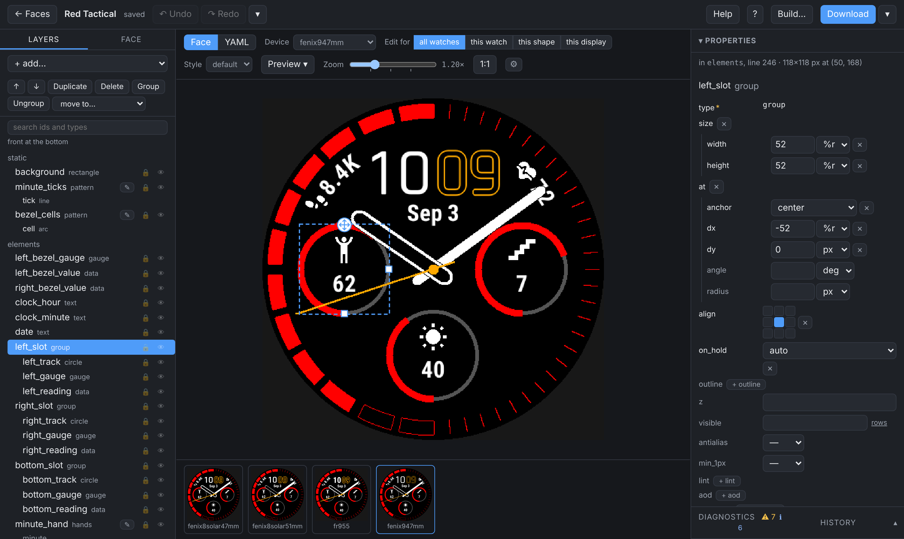

*`wfb studio` with Red Tactical, a face made with it and running on its
author's watch: layers on the left, the face at the centre with the selected
subdial's handles, every target watch underneath, and the subdial's keys in
Properties.*

## The editor

`wfb studio` runs on your own computer and opens in the browser. Everything
you do in it is written to a plain YAML design file, so you can switch
between dragging and typing at any point without losing anything.

- **Edit on the face.** Click to select, drag to move, pull handles to
  resize a box, a ring, an arc's ends, a line or a polygon's points. Moves
  snap to the screen's centre, to other elements' edges and centres, and to
  a grid in screen-relative units. You can move several elements at once or
  nudge them with the arrow keys. Double-click a set of hands, a tick
  pattern or a gauge needle in Layers to edit its parts in the frame they
  turn in.
- **Every watch at once.** The face is drawn at the resolution of the
  watch you're editing, by rules fitted to the Connect IQ simulator's own
  pixels, with a thumbnail for every other target underneath. Place an element once for
  every watch, or override it for one watch, one screen shape or one display
  type. **1:1** shows the watch at its real size.
- **Preview any moment.** Set the time and date or let it run live, choose
  what each complication slot shows, and switch between the awake,
  low-power and AMOLED always-on frames and the wearer's styles.
- **Properties that know the format.** Each key gets the right control: a
  text template edited as chips, colours that follow data edited as rules,
  a colour picker built around the 64 colours a MIP screen shows exactly,
  and a card for each complication slot listing every Garmin data type with
  its icon and sample reading.
- **The whole face in one tab.** Colours and schemes, the styles the wearer
  picks from, complication slots, fonts (drop in a TTF), and hand sets
  started from presets.
- **A YAML editor, too.** Completion and hover explanations come from the
  format's schema, and the compiler's diagnostics appear in the gutter.
  Selecting an element on the face selects its lines. The file you
  download is still your own: your units, your layout and your comments
  survive.
- **Checked as you go.** Warnings about each watch (text that won't fit,
  colours that dither, APIs a watch lacks, the memory budget) are listed
  live, and clicking one selects the element it is about.
- **Nothing gets lost.** Undo and redo survive restarts, the change
  history can be browsed, and snapshots are taken automatically. Faces live
  in the browser's own storage, and everything except building works
  offline.
- **Build and sideload.** **Build…** compiles the face for any installed
  watch and downloads its signed `.prg`, with its memory use against that
  watch's limit.

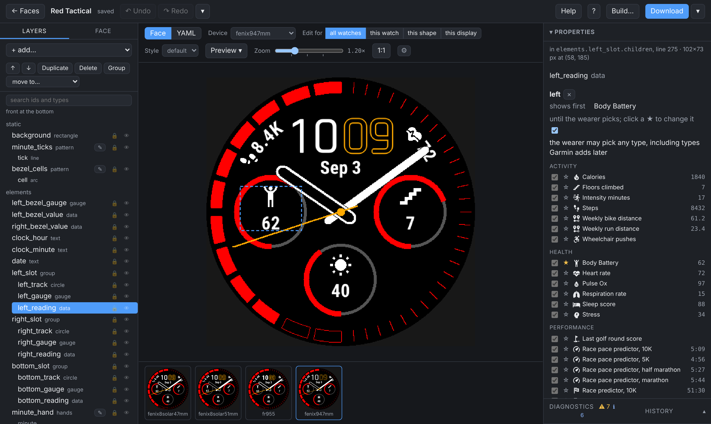

*A complication slot's card: tick the Garmin data types the wearer may pick
on the watch, star the one it shows first, and see each type's icon and
sample reading.*

[**The editor guide**](docs/guide/studio.md) covers every gesture, panel
and shortcut.

## Quick start

```sh
./tools/setup-env.sh              # SDK, signing key, fonts, Node (Linux or macOS)
alias wfb="$PWD/wfb"
wfb studio                        # open the address it prints, then New face or Open
```

[**Getting started**](docs/guide/getting-started.md) covers setup, the
device files you need, and how to copy the face onto your watch.

- **Watches:** any Connect IQ watch that runs faces at API 3.2 or newer (the
  fēnix 6 / Forerunner 245 generation onwards). Every limit is read from
  Garmin's own device files, not hardcoded. The examples are tested on the
  fēnix 8 Solar and the Forerunner 955.
- **Distribution:** personal sideloading over USB, not the Connect IQ Store.
- **Status:** early (`wfb` 0.1.0, `format: 2`). It works end to end and is still changing. See [what isn't built yet](docs/limitations.md#2-not-implemented-yet).

## Under the hood: one YAML file

Every face is one YAML design file: the layout, the data it shows and what
the wearer may change. `wfb` checks it against each watch's own limits,
generates the Monkey C code (Garmin's programming language) and runs
Garmin's compiler. The editor is the easiest way to write that file, but
not the only one. The same compiler works from the command line, for a
text editor, scripts or CI:

```sh
wfb new "My Face"                 # a working face from a template
wfb preview my-face.yaml --watch  # a PNG that redraws every time you save
wfb build my-face.yaml            # one signed .prg per watch
```

A complete face (a clock) is under 20 lines:

```yaml
format: 2
face: { id: 6f1c2b7e-3d4a-4e5f-9a1b-2c3d4e5f6a7b, name: Minimal Clock, version: 1.0.0 }
build:
  targets: [fenix8solar47mm, fenix8solar51mm, fr955]
resources:
  palette:
    fg: "#FFFFFF"                    # MIP screens: each channel 00, 55, AA or FF
elements:
  clock:
    type: text
    text: "{time.clock:%H:%M}"
    font: FONT_NUMBER_HOT
    at: { anchor: center }
    align: center
    color: color.fg
```

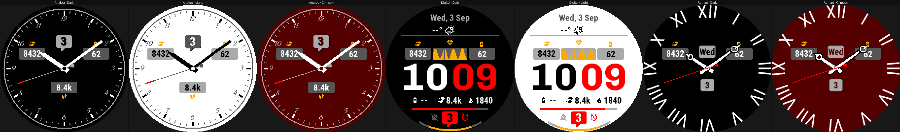

*[`examples/showcase`](examples/showcase/face.yaml): one YAML file, seven
styles the wearer switches between on the watch.*

## What you can build

| | |
|---|---|
| 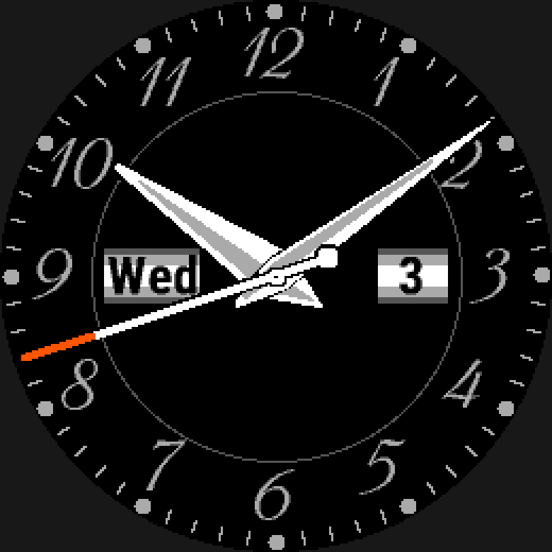<br>**Analog dials.** Hands built from polygons, lines and circles, plus a second hand that hides while the watch sleeps. → [Analog hands](docs/guide/analog-hands.md) | 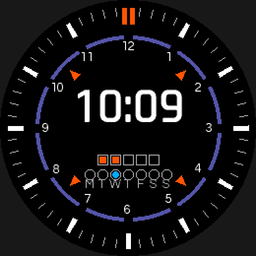<br>**Ticks, numerals and repeats.** One template repeated around a dial or along a line: 60 ticks or 12 numerals as a single element. → [Patterns](docs/guide/patterns.md) |
| 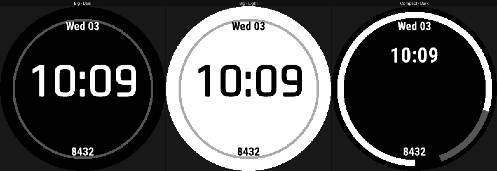<br>**Styles the wearer picks.** Layouts and colour schemes combined into named styles, chosen in the watch's own face editor. → [Styles and layouts](docs/guide/styles-and-layouts.md) | 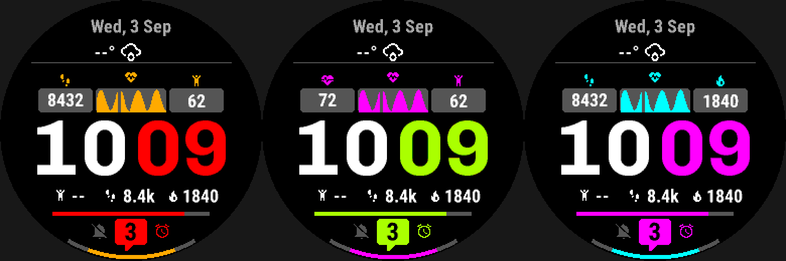<br>**On-device settings.** Accent and data colours, and data slots the wearer points at any Garmin metric. → [Configuration](docs/guide/configuration.md) |
| <br>**Your own fonts.** A TTF is converted to a bitmap font at build time, sized relative to each screen, with an option to make digits monospaced so the clock doesn't jitter. → [Fonts](docs/guide/fonts.md) | 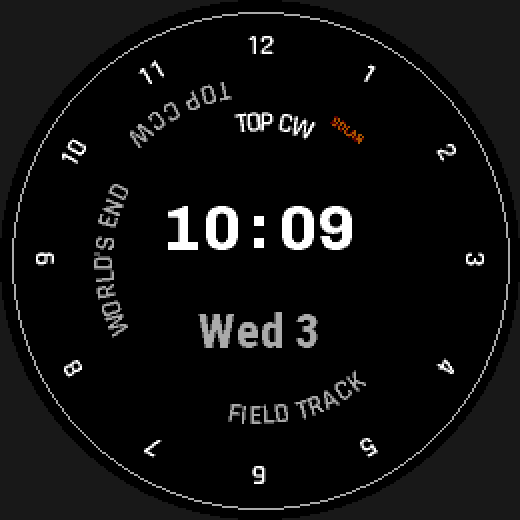<br>**Rotated and curved text.** Text that follows the bezel, using the fonts built into newer watches. → [Text](docs/guide/text.md) |
| 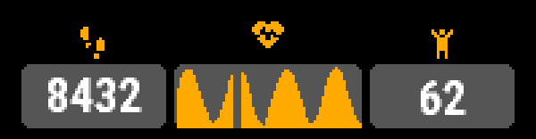<br>**Live data and history graphs.** Steps, heart rate, weather, battery, Garmin complications, and line, area or bar graphs. → [Data](docs/guide/data.md), [Graphs](docs/guide/progress-and-graphs.md) | <br>**Icons, groups and gauges.** About 10,000 Nerd Fonts glyphs, groups that move together, and gauge bars and arcs. → [Icons](docs/guide/icons.md), [Elements](docs/guide/elements.md) |
| 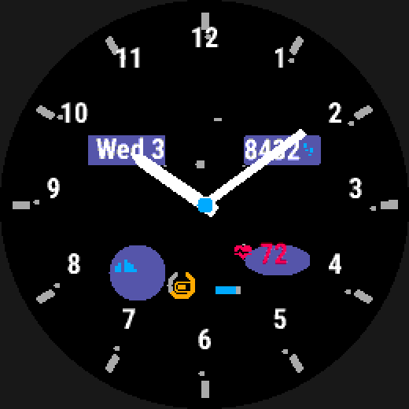<br>**Placement that scales.** Anchors, polar coordinates and screen-relative units, so one design fits every screen size. → [Placement](docs/guide/placement.md) | 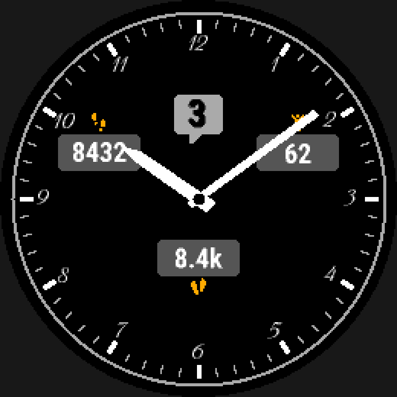<br>**Sleep mode and touch and hold.** Choose what redraws while the watch sleeps, and what a touch and hold opens. → [Modes and interaction](docs/guide/modes-and-interaction.md) |

Every build is also **checked against each watch**: text that won't fit,
colours the screen can only dither, shapes outside the visible area, APIs a
watch lacks, and the memory budget. → [Lints](docs/guide/lints.md)

## Documentation

| | |
|---|---|
| [**The guide**](docs/README.md) | every feature, one chapter each, with examples and every YAML key |
| [Example faces](examples/README.md) | complete faces to copy from, plus one test face per feature |
| [Limitations](docs/limitations.md) | what the platform can't do, and what isn't built yet |
| [Running in Docker](docs/container.md) · [Developing `wfb`](docs/development.md) | installing without setup, and working on the compiler itself |
| [Design decisions](docs/adr/README.md) · [Research](docs/research/00-summary.md) | why it works the way it does |

## License

The code is MIT-licensed ([`LICENSE`](LICENSE)). The example fonts keep their
own licences: the SIL Open Font License, in an `OFL.txt` next to each set of
fonts, and Apache-2.0 for the test fixture's Open Sans. The Nerd Fonts icon
font isn't in the repository; setup downloads it with its licence.

Previews and width/height estimates for Garmin's own system fonts use free
stand-ins — Roboto, DejaVu, Bebas Neue, Rajdhani, and others, each an
`exact`/`family`/`substitute` match recorded in
[`ts/src/data/font-registry.json`](ts/src/data/font-registry.json) with its own pinned
source, licence (mostly Apache-2.0 or OFL-1.1) and rationale.
None of them is in the repository either; setup (or
`ts/tools/fetch-system-fonts.ts`) downloads whichever ones your installed devices
need, each with a licence file alongside it. If you have Garmin's own font
files — from the SDK Manager's `Fonts` directory — they take priority over
these stand-ins; put them at `vendor/fonts/` (gitignored, like
`vendor/devices/`: it's your own licensed copy, never committed) or point
`WFB_FONTS` at them. Decoding those files' own `.cft` bitmap format
([`ts/src/fonts/cft.ts`](ts/src/fonts/cft.ts)) is a port of the decode logic in
[`markw65/monkeyc-optimizer`](https://github.com/markw65/monkeyc-optimizer)
(`src/cftinfo.ts`, MIT licence), pinned at commit
`cea919a92da74de1f5d277064caa6f7920554af7`.

Garmin's SDK and device definitions are not part of this project, and
Garmin's own terms cover them.
