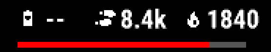

# Icons

`type: icon` draws a single glyph — a metric's conventional icon, any glyph
from the vendored Nerd Fonts font, or one chosen on-device from live data —
as cheaply as a line of text, since that's exactly what it is under the hood.


*Icon clusters, from `examples/showcase/face.yaml` — see also the
[data slots](data.md) screenshot for the steps icon and heartbeat glyph.*

## At a glance

| Key | Values | Default | Meaning |
|---|---|---|---|
| `icon:` | a catalogue name (`steps`, `heart`, `weather_<condition>`, …) | — | [`icon`](#icon) |
| `icon: {codepoint:}` | `"U+XXXX"` | — | [Beyond the named icons](#icon) — any glyph the catalogue doesn't name |
| `icon: {for:}` | `weather.condition`/`.condition_today`/`.condition_tomorrow`, or `complication.solar_input` | — | [A dynamic icon: `icon: {for:}`](#a-dynamic-icon-icon-for) — chosen on-device |
| `slot:` (instead of `icon:`) | a `config: slots:` name | — | [A slot's icon: `slot:`](#a-slots-icon-slot) — the icon of the wearer's pick |
| `size:` | `Length` (`px`/`%r` only) | — | [`icon`](#icon) |
| `rotate:` | `Angle`, clockwise | `0deg` (upright) | [A turned icon: `rotate:`](#a-turned-icon-rotate) |
| `color:` | colour expression | — | [Colours](colors.md) |
| `align:` | one of the nine anchor names, or a compass alias | `center` | [Placement: `at:` and `align:`](placement.md#placement-at-and-align) |

## Example

Icons are glyphs from the [Nerd Fonts](https://www.nerdfonts.com) "Symbols
Only" font, about 10,000 of them. `tools/setup-env.sh` downloads the font; it
isn't stored in this repository. The build bakes only the glyphs you use into
the face, the same way it bakes a custom text font. Each icon costs one small
bitmap, and no image files ship.

```yaml
steps_icon:                          # a named icon: `wfb sources` lists the names
  type: icon
  icon: steps
  size: 9%r                          # px or %r
  color: color.fg

hr_graph_icon:                       # any Nerd Fonts glyph, by codepoint
  type: icon
  icon: { codepoint: "U+F21E" }      # nf-fa-heartbeat
  size: 9%r

weather_icon:                        # chosen on the watch from live data
  type: icon
  icon: { for: weather.condition_today }
```

The [data slots](data.md) screenshot shows the steps icon and the heartbeat glyph, and the [placement](placement.md)
screenshot shows the weather icon.

- **Named icons** (`icon:`) cover the common metrics: steps, heart, flame,
  battery, notification, alarm, and so on, plus a `weather_*` set.
- **Any other glyph:** find it on the
  [Nerd Fonts cheat sheet](https://www.nerdfonts.com/cheat-sheet), then write
  its code as `icon: {codepoint: "U+XXXX"}`. The build checks that the font has it.
- **`icon: {for:}`** picks the glyph on the watch at runtime: the weather
  condition's, or a [level icon](#a-level-icon) that fills with its reading.

### `icon`

```yaml
steps_icon:
  type: icon
  icon: steps                 # alarm | battery | distance | dnd | flame | floors | heart |
                               # notification | phone | steps, plus the `weather_*` glyphs the
                               # Weather.CONDITION_* values map to -- run `wfb sources` for the
                               # full, current list
  size: 30px                  # px or %r only -- see below
  color: color.accent
```

An icon is a single glyph from an icon font
([Nerd Fonts](https://www.nerdfonts.com)' "Symbols Only" build, which
`tools/setup-env.sh` downloads; it is not committed), baked into a
bitmap font sheet at build time — the same pipeline that bakes a `fonts:`
entry, subsetted to exactly the glyphs a design uses. Drawing an icon is
drawing text: one `drawText` call against that baked font. No image ships in
the `.prg`; the resource cost is the same small per-glyph bitmap a custom text
font pays.

`align:` follows the one placement rule every accepting kind
shares: [Placement: `at:` and `align:`](placement.md#placement-at-and-align) — an icon is
a glyph kind, so it places the same way `text` does, by a runtime justify on
the device, not a moved build-time box.

**`size:` accepts only `px` and `%r`, not `%` or `pt`.** The icon's font has to
be baked once, before layout runs, so its size cannot depend on a parent box
(`%`) or another element's own font (`pt`) — both are only known once layout
has already happened. `%r` is recommended, for the same reason it is
recommended everywhere else: it means the same thing regardless of screen size.

**What `size:` measures depends on who picks the glyph.** A fixed icon (a
name or a codepoint) is baked so its ink is `size:` tall. An icon whose
glyph the watch picks (`slot:`, `icon: {for:}`) is baked glyph by glyph,
each so its ink's longer side is `size:`: every glyph fits the same
`size:` square, so a wide glyph (`steps`) is no bigger than a tall one
(`heart`), whichever the wearer picks or the weather brings. The font's
line is the largest glyph's, and each glyph is centred in it.

**The catalogue prefers Material Design Icons** (`nf-md`, the icon font's
largest and most consistent set) whenever a glyph reads at least as well as an
alternative. Weather icons (`weather_*`) are MDI's weather
set too, named after their MDI glyphs (`weather_partly_rainy`,
`weather_snowy_heavy`), except dust, sand, volcanic ash and the unknown
condition, which MDI lacks and the font's Weather Icons set supplies. Each
reads the same by day and by night, so a condition has one icon at any hour.
`GARMIN_WEATHER_CONDITION_ICON` in `ts/src/icons.ts` maps every
`Toybox.Weather.CONDITION_*` value (0–53) to one of these.

**Beyond the named icons**, the icon font has on the order of ten thousand
glyphs, including codepoints above the Basic Multilingual Plane (all of MDI's
own icons live there). Reach one with **`icon: {codepoint: "U+XXXX"}`**, a
codepoint in Unicode's own notation:

```yaml
repo:
  type: icon
  icon: { codepoint: "U+F09B" }   # nf-fa-github; find codepoints at nerdfonts.com/cheat-sheet
  size: 12%r
  color: color.dim
```

A codepoint is the **only** way to use an icon the catalogue does not name.
`icon:` once accepted a bare character pasted straight into the YAML; that was
removed. `U+F09B` is greppable, reviewable in a diff and survives copy-paste,
where the character itself renders as a blank box — or as nothing at all — in
most editors, and a paste that silently fails still parses as valid YAML. That
is the same hazard `ts/assets/icons/README.md` warns about for this project's
own catalogue, and it applies just as much to a design file.

`icon:` takes exactly one of a name, `{codepoint:}` or `{for:}`: a bare
string is always a catalogue name, and a `"U+XXXX"` string is refused with
the object to write instead. Writing a
codepoint the catalogue *does* name is accepted with a note pointing at the
name, which is the better spelling: a name
keeps meaning if the catalogue moves that icon to a different codepoint, which
has already happened once (the Font Awesome → Material Design Icons switch).

A codepoint the font does not carry is a build error, checked against the
font's own character map — the same way a custom font's glyph coverage is
checked, and for the same reason: the alternative is a blank tile discovered on
the wrist. A codepoint above the Basic
Multilingual Plane builds and renders correctly; the generated `<font>`
resource simply omits its `filter` attribute, because the resource compiler
parses that attribute as UTF-16 code units and a surrogate pair would not
survive it (see `ts/src/emit/resources.ts`). See `ts/assets/icons/README.md` for
how to find a codepoint, and its licensing (the font aggregates several
separately-licensed icon sets under Nerd Fonts' MIT patcher; the ones the named
catalogue draws from are attributed there).

#### A turned icon: `rotate:`

```yaml
steps_icon:
  type: icon
  icon: steps
  size: 10%r
  rotate: -46deg              # clockwise from upright; negative turns counter-clockwise
  at: { anchor: center, dx: -64%r, dy: -48%r }
```

`rotate:` turns the glyph clockwise from upright, by any angle, so it can
stand along the bezel beside curved text. **The glyph is baked already
turned**: the build rotates the glyph's outline and then rasterises it, so
a turned icon's edge is as clean as an upright one's. On the watch it is
still one `drawText`, on every device, with no API it needs and no cost
beyond its own font. A turned icon gets a font of its own, holding only the
glyphs it can draw. A whole turn (`360deg`) is the upright icon.

The glyph turns about the point a centred `drawText` puts at `at:` (half
its advance across, half the line down), so the icon stays where the
upright one would have been drawn. The size is set before turning: an icon
is the same size at every angle. **The watch clips a glyph to its cell**
(its advance across, the font's line down), and turned ink can reach past
it: a tall glyph turned a quarter is wider than its advance. So a turned
glyph's cell grows evenly about its centre until the ink fits, which keeps
the centred glyph where it was and stops the watch cropping its edge; the
lint box is that cell. `rotate:` works with `icon: {for:}` (every glyph
the lookup can return is turned alike) and with `outline:` (the ring is
grown from the turned glyph).

#### A slot's icon: `slot:`

```yaml
config:
  slots:
    left: { default: steps, choices: [steps, floors_climbed, body_battery, stress] }

elements:
  left_icon:
    type: icon
    slot: left                # instead of icon:
    size: 10%r
    rotate: -46deg
    at: { anchor: center, dx: -64%r, dy: -48%r }
    color: color.fg
    on_hold: auto             # opens the glance of whatever is picked
```

`slot:` names a [`config: slots:`](configuration.md#the-data-axis) slot in
place of `icon:`. The glyph is then the icon of whatever the wearer picked
for that slot, chosen on the watch, exactly as a `type: data` element
chooses its own: from the picked type, by the slot's catalogue icons and
its per-choice `icon:` overrides, with a weather type's icon following a
weather condition ([configuration](configuration.md)). It is the icon of a slot on its own, placed and turned
freely, beside the slot's [gauge](progress-and-graphs.md#gauges-on-a-slot)
and its `type: data` reading drawn without an `icon:`
([`examples/features/curved-slot`](../../examples/features/curved-slot/face.yaml)
puts all three round the bezel; its screenshot is in
[A curved reading](configuration.md#a-curved-reading-curve)).

* `icon:` and `slot:` both choose the glyph, so an element takes one or
  the other; both is an error.
* The icon follows the picked *type*, not the reading, so it draws on a
  frame the reading could not be pulled, as a data element's icon does. A
  pick with no icon (a Connect IQ app's complication under `choices: any`,
  or a choice with `icon: none`) draws nothing.
* `on_hold:` accepts `auto` only: the glance of the current pick, read at
  every hold. A fixed target would disagree with the icon the moment the
  wearer picks something else.
* The icon font holds every glyph the slot's choices can show, at this
  element's `size:` and `rotate:`. A data element's icon of the same size
  on the same slot shares the font.
* The native editor's highlight for the slot covers this icon too, and the
  editor draws it in each choice it previews.

#### A dynamic icon: `icon: {for:}`

A name or codepoint is a fixed glyph, chosen at build time. `icon: {for:}`
instead chooses the glyph on-device, at runtime, from a bound value:

```yaml
weather_now:
  type: icon
  icon: {for: weather.condition}  # or weather.condition_today / .condition_tomorrow
  size: 20%r
  color: color.text
```

It accepts a bare `weather.condition*` source (see `wfb sources`) or a
[level icon's](#a-level-icon) source — not an expression over one
(`weather.condition + 1` is rejected; the lookup needs the raw
`Weather.CONDITION_*` value or the raw 0-100 reading). The generated code
resolves the glyph in two steps, mirroring `ts/src/icons.ts` exactly: `WfbWeather.
chooseIcon()` (a hand-written barrel function) turns the
condition into a catalogue *name*, and `IconGlyphs.glyph()` — generated fresh
each build directly from the icon catalogue, not hand-written — turns that
name into the actual character. A weather condition is not a special case on
the device side any more than it is in the catalogue: the same `IconGlyphs`
table is where any dynamic icon's name becomes a glyph. Because the actual
glyph is not known until runtime, its font bakes *every* glyph the lookup
could return rather than one — still cheap: baking is still a small per-glyph
bitmap, just several of them sharing one font instead of one glyph having its
own.

When the bound value is absent (no cached weather data yet), the icon simply
does not draw — the same `hide`-by-default behaviour any other nullable
binding with `absent: hide` has, deliberately: a placeholder
"unknown" glyph on first launch, before Weather has ever synced, would read
as a real (if odd) forecast rather than as "not ready yet".

#### A level icon

Some metrics have an icon that fills with the reading, a value from 0 to
100. `icon: {for:}` on one of their sources draws the step the reading
falls in, and so does a [slot](#a-slots-icon-slot) showing that metric
(and a `type: data` element's icon on it):

| Metric | Source | Slot type | Steps |
|---|---|---|---|
| Solar input | `complication.solar_input` | `solar_input` | `solar_level_0`…`solar_level_8`: an empty circle, then one more eighth filled per step (Material Design `circle_outline`, `circle_slice_1`…`8`) |

```yaml
solar:
  type: icon
  icon: {for: complication.solar_input}
  size: 18%r
  color: color.accent
```

* **The steps are equal bands of 0-100**, the reading truncated into one:
  solar's nine bands are 11.1 wide, so 0-11 is the empty circle, 12-22 one
  eighth, and 89-100 the full circle.
* **Without a reading the metric's plain icon draws** (`solar`, the sun),
  as a slot's icon does: it still says which metric this is. On a frame
  that has one, the step replaces it.
* **Every step is the same size.** Each step's glyph has the same ink box,
  so the icon only fills, never jumps, and the font holds every step and
  the plain icon, baked at `size:`.
* **A slot choice with an authored `icon:` keeps it**, as a weather or a
  notification count choice does.
* `IconGlyphs.<metric>Level()`, generated beside `IconGlyphs.glyph()`,
  turns the reading into the step's catalogue name on the watch; the
  preview draws the same step from the sample reading.
* The steps are catalogue names too, so `icon: solar_level_4` draws one
  step on its own.

### Your own icon font

**Your own icon font** also works, through a plain `text` element. Add any TTF,
such as a full Nerd-patched font, to `resources: fonts:`, and write the glyph
as a YAML escape:

```yaml
resources:
  fonts:
    myicons: { source: assets/MyIcons.ttf, size: 20%r }
elements:
  github:
    type: text
    text: "\uF09B"                        # use "\U000F140B" above U+FFFF
    font: font.myicons
```

A text element doesn't get the icon's size correction or the build's
glyph-exists check. Also avoid spaces between glyphs: a symbols-only font has
no space character, and the preview draws it as an empty box.

An icon takes `outline:`: the build bakes the icon's glyph dilated by the
ring's width (1px unless `{color, width}` says 2 or 3) into a companion
font and draws it once, in the ring colour, before the icon -- so an
opening inside the icon wider than twice the ring keeps a ring of its own. See [Outlines](outlines.md).

## See also

- [`examples/showcase/face.yaml`](../../examples/showcase/face.yaml) — the icon clusters shown above.
- [Outlines](outlines.md) — `outline:` on an icon, openings included.
- [`ts/assets/icons/README.md`](../../ts/assets/icons/README.md) — finding a codepoint, licensing, and adding a name to the catalogue.
- [Fonts](fonts.md#fonts) — the same TTF-to-bitmap pipeline an icon font uses.
- [Elements: common keys and groups](elements.md) — `visible:`, `static:`, and the other keys an icon element shares with every other kind.
