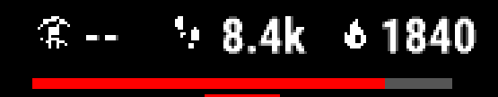
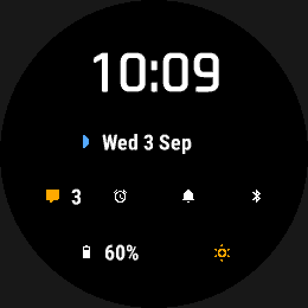

# Icons

`type: icon` draws a single glyph — a metric's conventional icon, any glyph
from the vendored Nerd Fonts font, or one chosen on-device from live data —
as cheaply as a line of text, since that's exactly what it is under the hood.


*Icon clusters, from `examples/showcase/face.yaml` — see also the
[data slots](data.md) screenshot for the steps icon and heartbeat glyph.*

## At a glance

| Key | Values | Default | Meaning |
|---|---|---|---|
| `icon:` | a catalogue name (`steps`, `heart`, `weather_<condition>`, …) | — | [`icon`](#icon) |
| `icon: {codepoint:}` | `"U+XXXX"` | — | [Beyond the named icons](#icon) — any glyph the catalogue doesn't name |
| `icon: {for:}` | a source an icon rule follows, by rule: weather (`weather.condition`/`.condition_today`/`.condition_tomorrow`, `complication.current_weather`/`.forecast_weather_1day`/`_2day`/`_3day`), battery (`system.battery`, `complication.battery`), solar (`complication.solar_input`), notification (`device.notification_count`, `complication.notification_count`), alarm (`device.alarm_count`), do-not-disturb (`device.do_not_disturb`), phone (`device.phone_connected`), moon (`astro.moon_age`) | — | [A dynamic icon: `icon: {for:}`](#a-dynamic-icon-icon-for) — chosen on-device |
| `icon: {for:, variant:}` | `fill`, `bars` or `classic` (a battery source only) | `fill` | [The battery's variants](#the-batterys-variants-variant) — which glyph set the battery steps through |
| `slot:` (instead of `icon:`) | a `config: slots:` name | — | [A slot's icon: `slot:`](#a-slots-icon-slot) — the icon of the wearer's pick |
| `absent:` | `hide`, or `{icon: <name>}` / `{icon: {codepoint: "U+XXXX"}}` (with `icon: {for:}` or `slot:` only) | the plain glyph | [`absent:` on an icon](#absent-on-an-icon) — what draws without a reading |
| `size:` | `Length` (`px`/`%r` only) | — | [`icon`](#icon) |
| `rotate:` | `Angle`, clockwise | `0deg` (upright) | [A turned icon: `rotate:`](#a-turned-icon-rotate) |
| `color:` | colour expression | — | [Colours](colors.md) |
| `align:` | one of the nine anchor names, or a compass alias | `center` | [Placement: `at:` and `align:`](placement.md#placement-at-and-align) |

## Example

Icons are glyphs from the [Nerd Fonts](https://www.nerdfonts.com) "Symbols
Only" font, about 10,000 of them. `tools/setup-env.sh` downloads the font; it
isn't stored in this repository. The build bakes only the glyphs you use into
the face, the same way it bakes a custom text font. Each icon costs one small
bitmap, and no image files ship. Two kinds of icon are exceptions to "a glyph
from the font", because the font has nothing like them: the solar level steps
(solar input filling up) and `body_battery` (a head and shoulders inside a
gauge that thickens as it sweeps from bottom left to top right, the outline of
the watch's own Body Battery icon). The build draws those itself when it bakes
the font.

```yaml
steps_icon:                          # a named icon: `wfb sources` lists the names
  type: icon
  icon: steps
  size: 9%r                          # px or %r
  color: color.fg

hr_graph_icon:                       # any Nerd Fonts glyph, by codepoint
  type: icon
  icon: { codepoint: "U+F21E" }      # nf-fa-heartbeat
  size: 9%r

weather_icon:                        # chosen on the watch from live data
  type: icon
  icon: { for: weather.condition_today }
```

The [data slots](data.md) screenshot shows the steps icon and the heartbeat glyph, and the [placement](placement.md)
screenshot shows the weather icon.

- **Named icons** (`icon:`) cover the common metrics: steps, heart, flame,
  battery, notification, alarm, and so on, plus a `weather_*` set.
- **Any other glyph:** find it on the
  [Nerd Fonts cheat sheet](https://www.nerdfonts.com/cheat-sheet), then write
  its code as `icon: {codepoint: "U+XXXX"}`. The build checks that the font has it.
- **`icon: {for:}`** picks the glyph on the watch at runtime, by an
  [icon rule](#an-icon-that-follows-a-reading): the weather condition's, a
  battery that fills with its reading, a notification bubble that empties
  at zero, an alarm, do-not-disturb or phone status, or the moon's phase.

### `icon`

```yaml
steps_icon:
  type: icon
  icon: steps                 # alarm | battery | distance | dnd | flame | floors | heart |
                               # notification | steps, plus the `weather_*` glyphs the
                               # Weather.CONDITION_* values map to -- run `wfb sources` for the
                               # full, current list
  size: 30px                  # px or %r only -- see below
  color: color.accent
```

An icon is a single glyph from an icon font
([Nerd Fonts](https://www.nerdfonts.com)' "Symbols Only" build, which
`tools/setup-env.sh` downloads; it is not committed), baked into a
bitmap font sheet at build time — the same pipeline that bakes a `fonts:`
entry, subsetted to exactly the glyphs a design uses. Drawing an icon is
drawing text: one `drawText` call against that baked font. No image ships in
the `.prg`; the resource cost is the same small per-glyph bitmap a custom text
font pays.

`align:` follows the one placement rule every accepting kind
shares: [Placement: `at:` and `align:`](placement.md#placement-at-and-align) — an icon is
a glyph kind, so it places the same way `text` does, by a runtime justify on
the device, not a moved build-time box.

**`size:` accepts only `px` and `%r`, not `%` or `pt`.** The icon's font has to
be baked once, before layout runs, so its size cannot depend on a parent box
(`%`) or another element's own font (`pt`) — both are only known once layout
has already happened. `%r` is recommended, for the same reason it is
recommended everywhere else: it means the same thing regardless of screen size.

**What `size:` measures depends on who picks the glyph.** A fixed icon (a
name or a codepoint) is baked so its ink is `size:` tall. An icon whose
glyph the watch picks (`slot:`, `icon: {for:}`) is baked glyph by glyph,
each so its ink's longer side is `size:`: every glyph fits the same
`size:` square, so a wide glyph (`steps`) is no bigger than a tall one
(`heart`), whichever the wearer picks or the weather brings. The font's
line is the largest glyph's, and each glyph is centred in it. The element's
box (what the layout lints check, the `on_hold:` region and the native
editor's highlight) is that line tall and as wide as the widest glyph, so
it holds whichever one is drawn.

**The catalogue prefers Material Design Icons** (`nf-md`, the icon font's
largest and most consistent set) whenever a glyph reads at least as well as an
alternative. Weather icons (`weather_*`) are MDI's weather
set too, named after their MDI glyphs (`weather_partly_rainy`,
`weather_snowy_heavy`), except dust, sand, volcanic ash and the unknown
condition, which MDI lacks and the font's Weather Icons set supplies. Each
reads the same by day and by night, so a condition has one icon at any hour.
The weather rule's `map` in `ts/src/data/icons.json` maps every
`Toybox.Weather.CONDITION_*` value (0–53) to one of these.

**Beyond the named icons**, the icon font has on the order of ten thousand
glyphs, including codepoints above the Basic Multilingual Plane (all of MDI's
own icons live there). Reach one with **`icon: {codepoint: "U+XXXX"}`**, a
codepoint in Unicode's own notation:

```yaml
repo:
  type: icon
  icon: { codepoint: "U+F09B" }   # nf-fa-github; find codepoints at nerdfonts.com/cheat-sheet
  size: 12%r
  color: color.dim
```

A codepoint is the **only** way to use an icon the catalogue does not name.
`icon:` once accepted a bare character pasted straight into the YAML; that was
removed. `U+F09B` is greppable, reviewable in a diff and survives copy-paste,
where the character itself renders as a blank box — or as nothing at all — in
most editors, and a paste that silently fails still parses as valid YAML. That
is the same hazard `ts/assets/icons/README.md` warns about for this project's
own catalogue, and it applies just as much to a design file.

`icon:` takes exactly one of a name, `{codepoint:}` or `{for:}`: a bare
string is always a catalogue name, and a `"U+XXXX"` string is refused with
the object to write instead. Writing a
codepoint the catalogue *does* name is accepted with a note pointing at the
name, which is the better spelling: a name
keeps meaning if the catalogue moves that icon to a different codepoint, which
has already happened once (the Font Awesome → Material Design Icons switch).

A codepoint the font does not carry is a build error, checked against the
font's own character map — the same way a custom font's glyph coverage is
checked, and for the same reason: the alternative is a blank tile discovered on
the wrist. A codepoint above the Basic
Multilingual Plane builds and renders correctly; the generated `<font>`
resource simply omits its `filter` attribute, because the resource compiler
parses that attribute as UTF-16 code units and a surrogate pair would not
survive it (see `ts/src/emit/resources.ts`). See `ts/assets/icons/README.md` for
how to find a codepoint, and its licensing (the font aggregates several
separately-licensed icon sets under Nerd Fonts' MIT patcher; the ones the named
catalogue draws from are attributed there).

#### A turned icon: `rotate:`

```yaml
steps_icon:
  type: icon
  icon: steps
  size: 10%r
  rotate: -46deg              # clockwise from upright; negative turns counter-clockwise
  at: { anchor: center, dx: -64%r, dy: -48%r }
```

`rotate:` turns the glyph clockwise from upright, by any angle, so it can
stand along the bezel beside curved text. **The glyph is baked already
turned**: the build rotates the glyph's outline and then rasterises it, so
a turned icon's edge is as clean as an upright one's. On the watch it is
still one `drawText`, on every device, with no API it needs and no cost
beyond its own font. A turned icon gets a font of its own, holding only the
glyphs it can draw. A whole turn (`360deg`) is the upright icon.

The glyph turns about the point a centred `drawText` puts at `at:` (half
its advance across, half the line down), so the icon stays where the
upright one would have been drawn. The size is set before turning: an icon
is the same size at every angle. **The watch clips a glyph to its cell**
(its advance across, the font's line down), and turned ink can reach past
it: a tall glyph turned a quarter is wider than its advance. So a turned
glyph's cell grows evenly about its centre until the ink fits, which keeps
the centred glyph where it was and stops the watch cropping its edge; the
lint box is that cell. `rotate:` works with `icon: {for:}` (every glyph
the lookup can return is turned alike) and with `outline:` (the ring is
grown from the turned glyph).

#### A slot's icon: `slot:`

```yaml
config:
  slots:
    left: { default: steps, choices: [steps, floors_climbed, body_battery, stress] }

elements:
  left_icon:
    type: icon
    slot: left                # instead of icon:
    size: 10%r
    rotate: -46deg
    at: { anchor: center, dx: -64%r, dy: -48%r }
    color: color.fg
    on_hold: auto             # opens the glance of whatever is picked
```

`slot:` names a [`config: slots:`](configuration.md#the-data-axis) slot in
place of `icon:`. The glyph is then the icon of whatever the wearer picked
for that slot, chosen on the watch, exactly as a `type: data` element
chooses its own: from the picked type, by the slot's catalogue icons and
its per-choice `icon:` overrides, with a weather type's icon following a
weather condition ([configuration](configuration.md)). It is the icon of a slot on its own, placed and turned
freely, beside the slot's [gauge](progress-and-graphs.md#gauges-on-a-slot)
and its `type: data` reading drawn without an `icon:`
([`examples/features/curved-slot`](../../examples/features/curved-slot/face.yaml)
puts all three round the bezel; its screenshot is in
[A curved reading](configuration.md#a-curved-reading-curve)).

* `icon:` and `slot:` both choose the glyph, so an element takes one or
  the other; both is an error.
* The icon follows the picked *type*, not the reading, so it draws on a
  frame the reading could not be pulled, as a data element's icon does,
  unless [`absent:`](#absent-on-an-icon) says otherwise. A
  pick with no icon (a Connect IQ app's complication under `choices: any`,
  or a choice with `icon: none`) draws nothing.
* `on_hold:` accepts `auto` only: the glance of the current pick, read at
  every hold. A fixed target would disagree with the icon the moment the
  wearer picks something else.
* The icon font holds every glyph the slot's choices can show, at this
  element's `size:` and `rotate:`. A data element's icon of the same size
  on the same slot shares the font, unless this icon's `absent: {icon:}`
  is a glyph none of the choices draws: that one font gets its own.
* The native editor's highlight for the slot covers this icon too, and the
  editor draws it in each choice it previews.

#### A dynamic icon: `icon: {for:}`

A name or codepoint is a fixed glyph, chosen at build time. `icon: {for:}`
instead chooses the glyph on-device, at runtime, from a bound value:

```yaml
weather_now:
  type: icon
  icon: {for: weather.condition}  # or weather.condition_today / .condition_tomorrow
  size: 20%r
  color: color.text
```

It accepts a bare source that an **icon rule** follows — not an expression
over one (`weather.condition + 1` is rejected; the lookup needs the raw
reading). The rules are one table, `rules` in `ts/src/data/icons.json`,
each naming the sources it follows and how it turns their reading into a
catalogue name: a *steps* rule orders its glyphs along the reading, split
into equal bands over a range or at thresholds, and a *table* rule (the
weather's) names a glyph for each value. Every rule, with its sources and
glyphs, is listed in [An icon that follows a reading](#an-icon-that-follows-a-reading).

The generated code resolves the glyph in two steps, mirroring
`ts/src/icons.ts` exactly: `IconGlyphs.<rule>Icon()` (`weatherIcon`,
`batteryIcon`, …), generated from the rule, turns the reading into a
catalogue *name*, and `IconGlyphs.glyph()` — generated fresh each build
directly from the icon catalogue, not hand-written — turns that name into
the actual character. A weather condition is not a special case on the
device side any more than it is in the catalogue: every rule's chooser is
generated the same way, only for the rules a face uses, and the same
`IconGlyphs` table is where any dynamic icon's name becomes a glyph.
An unaccepted `for:` source is an error that lists every accepted one. Because the actual
glyph is not known until runtime, its font bakes *every* glyph the lookup
could return rather than one — still cheap: baking is still a small per-glyph
bitmap, just several of them sharing one font instead of one glyph having its
own.

#### An icon that follows a reading



*[`examples/features/status/face.yaml`](../../examples/features/status/face.yaml): every icon here follows its reading.*

Each icon rule turns a reading into one of its glyphs. `icon: {for:}` on
one of the rule's sources draws that glyph, and so does a
[slot](#a-slots-icon-slot) showing a complication type the rule follows
(and a `type: data` element's icon on it). `wfb sources` prints the rule
under each source that has one.

| Rule | Sources (slot type) | Glyphs, in order | How the reading splits | Plain |
|---|---|---|---|---|
| `battery` | `system.battery`, `complication.battery` (`battery`) | `battery_20`, `battery_40`, `battery_60`, `battery_80`, `battery`: an upright battery a fifth full, then a fifth more per step, then full (Material Design `battery_20`…`_80`, `battery`); `variant:` picks [another set](#the-batterys-variants-variant) | five equal bands of 0–100: 0–19 % a fifth, 20–39 % two fifths, … 80–100 % full | `battery`, the full upright battery |
| `solar` | `complication.solar_input` (`solar_input`) | `solar_level_0`…`solar_level_8`: a disc with a lightning bolt cut out, and around it eight arcs, one more lit per step, clockwise from 12 o'clock | nine equal bands of 0–100, 11.1 wide: 0–11 lights no arc, 12–22 one, … 89–100 all eight | `solar`, the sun |
| `notification` | `device.notification_count`, `complication.notification_count` (`notification_count`) | `notification_none` (an outlined speech bubble), `notification` (a filled one) | at 1: exactly 0 is the empty bubble, 1 or more the filled one | `notification` |
| `alarm` | `device.alarm_count` | `alarm_off` (the alarm clock struck through), `alarm` | at 1: no alarm set is the struck clock | `alarm` |
| `dnd` | `device.do_not_disturb` | `bell` (do-not-disturb off), `dnd` (the bell struck through: on) | off / on | `bell` |
| `phone` | `device.phone_connected` | `phone_disconnected` (the Bluetooth rune struck through), `phone_connected` (the rune, as Garmin's own status row draws it) | off / on | `phone_connected` |
| `moon` | `astro.moon_age` | `moon_new`, `moon_waxing_crescent`, `moon_first_quarter`, `moon_waxing_gibbous`, `moon_full`, `moon_waning_gibbous`, `moon_last_quarter`, `moon_waning_crescent` | eight equal bands of the 29.53-day cycle, each centred on its phase: new is 27.68 days round to 1.85, full 12.92–16.61 | `moon_new` |
| `weather` | `weather.condition`, `.condition_today`, `.condition_tomorrow`; `complication.current_weather`, `.forecast_weather_1day`/`_2day`/`_3day` | the `weather_*` icons | each `Weather.CONDITION_*` value to its icon | `weather_unknown` |

In the editor, the icon picker's **follows data** tab lists every rule
with the glyphs it draws and writes `icon: {for:}` for the source you pick
([Studio](studio.md#an-icon)).

#### The battery's variants: `variant:`

The battery comes in three glyph sets over the same five bands. `variant:`
beside `for:` picks one; a [slot choice](configuration.md) takes it as
`{type: battery, variant: <name>}`.

| `variant:` | Glyphs, in order | Plain |
|---|---|---|
| `fill` (the default) | `battery_20`, `battery_40`, `battery_60`, `battery_80`, `battery`: upright, filled from the bottom (Material Design) | `battery` |
| `bars` | `battery_outline`, `battery_low`, `battery_medium`, `battery_high`, `battery`: upright, empty, then one to three bars, then full (Material Design) | `battery` |
| `classic` | `battery_level_0`…`battery_level_4`: lying down, empty, then a quarter more per step (Font Awesome `battery_empty`, `_quarter`, `_half`, `_three_quarters`, `_full`) | `battery_classic`, the three-quarter battery lying down |

```yaml
battery:
  type: icon
  icon: {for: system.battery, variant: bars}
  size: 16%r
  color: color.fg
```

* **`fill` is the default** because it matches the weight of the other
  Material Design icons and has no gaps to round: each step moves one edge,
  so every level stays distinct at any size.
* **`bars` draws its gaps evenly only at some sizes.** Its three bars sit
  one design unit apart, so most pixel sizes round the gaps unevenly, and
  below about 19 px of ink a bar merges with its neighbour. On a 260 px
  screen (radius 130) `15%r` and `17%r`–`18%r` bake even gaps; look at the
  preview before choosing another size.
* **`classic` lies down**, so at a given `size:` it is wider and shorter
  than the upright sets: an icon whose glyph the watch picks is sized by its
  longer side ([`size:`](#icon)). It is heavier than the other icons.
* Only the battery has variants. `variant:` on another source, on a slot
  choice of another type, or beside a choice's own `icon:` is an error.
* Each variant is a rule of its own on the watch (`batteryIcon`,
  `batteryBarsIcon`, `batteryClassicIcon`), generated only when a face uses
  it, with a font of its own at each size.

```yaml
solar:
  type: icon
  icon: {for: complication.solar_input}
  size: 18%r
  color: color.accent

moon:
  type: icon
  icon: {for: astro.moon_age}
  size: 14%r
  color: color.fg

phone:
  type: icon
  icon: {for: device.phone_connected}
  size: 10%r
  color: color.fg
```

* **Equal bands are truncated**: the reading falls into the band it has
  reached, so a battery at 39 % is still a quarter, never rounded up to
  half. A threshold counts how many it has reached: a count of 0 is below
  1, and an on/off setting reads as 0 (off) or 1 (on).
* **The moon's bands wrap round.** Its first band is centred on the new
  moon, half a band either side of it, so an age of 28.5 days is new, not
  a waning crescent. The age comes from the date and the time on the watch
  ([Astronomy](data.md#astronomy)), so the icon needs no sync.
* **The new and the full moon are both plain discs**, as the glyph set
  draws them: `moon_new` is the disc's outline, nothing lit, and
  `moon_full` the disc filled. On a dark background that reads as night
  sky and moonlight; on a light one their feel inverts, the filled disc
  reading as the dark new moon, so pick the colour with the background in
  mind, or place a fixed `moon_new` behind the live icon as a track.
* **Without a reading the rule's plain icon draws**, as a slot's icon
  does, unless [`absent:`](#absent-on-an-icon) says otherwise: it still
  says which metric this is. A count that could not be
  pulled is not known to be zero, so it draws the filled bubble. Only the
  `complication.*` sources, and the weather ones, can be absent; the
  `system.*`, `device.*` and `astro.*` ones here are always there.
* **The icon changes in place.** Its font holds every glyph the rule can
  draw, the plain one included, baked at `size:`. The battery and solar
  steps share one ink box, so they only fill, never jump.
* **A slot choice with an authored `icon:` keeps it**, as a weather choice
  does.
* `IconGlyphs.<rule>Icon()` (`batteryIcon`, `moonIcon`, …), generated
  beside `IconGlyphs.glyph()` from the rule and only for the rules a face
  uses, turns the reading into the glyph's catalogue name on the watch; the
  preview draws the same glyph from the sample reading
  (`--sample device.notification_count=0` shows the empty bubble,
  `--sample astro.moon_age=14.8` the full moon).
* Each glyph is a catalogue name too, so `icon: solar_level_4` or
  `icon: moon_first_quarter` draws one on its own.
* `system.battery` is always there, so its icon is always a step; the two
  battery sources share one font at a size and variant.
* **Small solar icons.** An arc one or two pixels thick does not read, so
  a solar step drawn **under 22 px across** (its `size:` on that device)
  is a static icon instead: the same bolt in an eight-pointed star,
  whatever the reading. The choice is made per device, when the font is
  baked, so one face can show arcs on a large screen and the star on a
  small one. Keep a reading next to a small solar icon: the star alone
  does not show how much. The eight arcs (and the star's eight points)
  are laid out so each has the same pixels as the others, flipped or
  turned; that is why the star's points sit either side of 12 o'clock,
  not on it.
* **To show the notification count itself**, draw
  `{device.notification_count}` as text beside the icon with
  `visible: device.notification_count > 0`: the number goes at zero while
  the empty bubble stays ([Colours](colors.md) pairs the same two elements
  with a colour switch instead).

#### A track behind the arcs

Unlit arcs are not drawn. To show them dimmed, place the full step as a
fixed icon **behind** the live one, at the same `size:` and position; the
live icon's disc and lit arcs then cover it exactly:

```yaml
solar_track:
  type: icon
  icon: solar_level_8       # all eight arcs: the track
  size: 20%r
  at: {anchor: center}
  color: "#555555"          # dark grey, a MIP palette colour
  lint: {allow: [contrast], reason: "a dim track, on purpose"}
solar:
  type: icon
  icon: {for: complication.solar_input}
  size: 20%r
  at: {anchor: center}
  color: color.accent
```

Under 22 px both draw the same star, so the track is hidden there.

#### `absent:` on an icon

An icon that follows data, `icon: {for:}` or `slot:`, can lose its reading:
nothing synced yet, a complication that could not be pulled. `absent:`
says what it draws then:

```yaml
weather_now:
  type: icon
  icon: {for: weather.condition}
  size: 20%r
  color: color.text
  absent: {icon: weather_cloudy_alert}   # or: hide, or {icon: {codepoint: "U+F0026"}}
```

* **Omitted, the rule's plain glyph draws.** A weather icon with no
  condition draws `weather_unknown`, Weather Icons' `N/A` box, the same
  glyph `CONDITION_UNKNOWN` gets; a battery or solar icon draws its
  plain icon and a notification icon its filled one
  ([An icon that follows a reading](#an-icon-that-follows-a-reading)). The space is
  never left as a hole beside a `--` reading, and the `N/A` glyph says "no
  data" where a blank would say nothing.
* **`hide` draws nothing** while the reading is absent, as `absent: hide`
  does on every other element.
* **`{icon: <name>}`** (or `{icon: {codepoint: "U+XXXX"}}`) **draws that
  glyph instead**, checked against the catalogue and the icon font as
  `icon:` is. The font holds it beside the glyphs the icon can choose; one
  it already holds costs nothing.
* **On a `slot:` icon it follows the pick's reading**, not its type: the
  wearer's pick still chooses the icon, and the substitute (or nothing)
  draws on a frame that pick has no reading. A pick with no icon still
  draws nothing.
* An icon draws a glyph, so `{text:}` and `{value:}` are refused, and
  `absent:` on a fixed icon (a name or a codepoint) is an error: it has no
  reading to lose. On a source that is always there (`system.battery`,
  `device.notification_count`) it has no effect, and a note says so.
* The preview draws it from a null sample: `--sample weather.condition=null`.

### Your own icon font

**Your own icon font** also works, through a plain `text` element. Add any TTF,
such as a full Nerd-patched font, to `resources: fonts:`, and write the glyph
as a YAML escape:

```yaml
resources:
  fonts:
    myicons: { source: assets/MyIcons.ttf, size: 20%r }
elements:
  github:
    type: text
    text: "\uF09B"                        # use "\U000F140B" above U+FFFF
    font: font.myicons
```

A text element doesn't get the icon's size correction or the build's
glyph-exists check. Also avoid spaces between glyphs: a symbols-only font has
no space character, and the preview draws it as an empty box.

An icon takes `outline:`: the build bakes the icon's glyph dilated by the
ring's width (1px unless `{color, width}` says 2 or 3) into a companion
font and draws it once, in the ring colour, before the icon -- so an
opening inside the icon wider than twice the ring keeps a ring of its own. See [Outlines](outlines.md).

## See also

- [`examples/showcase/face.yaml`](../../examples/showcase/face.yaml) — the icon clusters shown above.
- [Outlines](outlines.md) — `outline:` on an icon, openings included.
- [`ts/assets/icons/README.md`](../../ts/assets/icons/README.md) — finding a codepoint, licensing, and adding a name to the catalogue.
- [Fonts](fonts.md#fonts) — the same TTF-to-bitmap pipeline an icon font uses.
- [Elements: common keys and groups](elements.md) — `visible:`, `static:`, and the other keys an icon element shares with every other kind.
