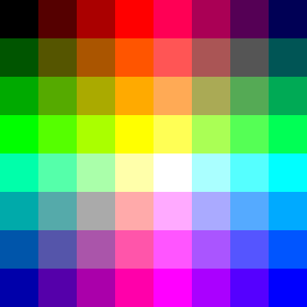
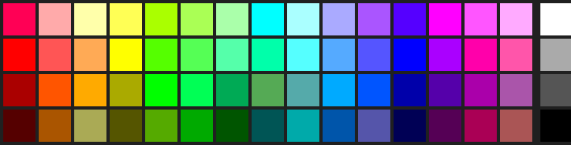
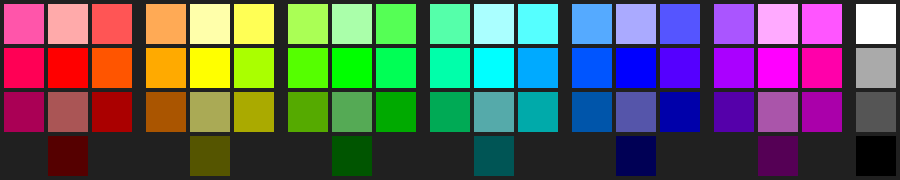
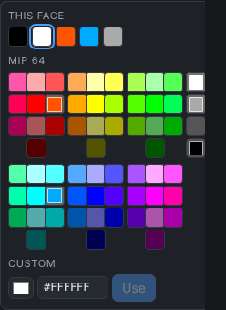

# 36 — Laying out the 64 MIP colours in two dimensions

**Question.** A MIP panel shows 64 colours: red, green and blue each at
`00`, `55`, `AA` or `FF`. How should they be arranged on a flat grid (the
editor's colour picker) so that similar colours sit together and the
colours change gradually across it?

**Short answer.** A perfect arrangement, where every pair of neighbours
differs by one step in one channel, does not exist on an 8×8 grid
(VERIFIED by exhaustive search, §2). The best layout found keeps 104 of the
112 neighbour pairs at one step and puts the other 8 on two seams where
blue moves two steps (§3). For a picker, what reads best is not a
smoothness optimum but a layout by colour family: four grays, and six hue
families of exactly ten colours each, every family drawn as the same 3×4
block of tones (§5). The editor's picker uses that layout.

Probe: `docs/research/probes/mip-palette-layout/` (the scripts and the
images below).

---

## 1. The set

The 64 colours are the points of a 4×4×4 cube, one axis per channel. Two
colours one step apart along one axis (`55` to `AA` in red, say) differ
least; that is the "neighbour" every layout below tries to keep side by
side. Distances in §4 use CIELAB (sRGB, D65), which tracks what the eye
sees better than channel steps do.

The structure that matters for §5: classify each colour by its brightest
and dimmest channel levels (max, min). Equal means gray (4 colours). The
other 60 fall into six tones:

| Tone | (max, min) | Count | Hue positions |
|---|---|---|---|
| pastel | (3, 2) | 6 | every 60° |
| light | (3, 1) | 12 | every 30° |
| vivid | (3, 0) | 18 | every 20° |
| muted | (2, 1) | 6 | every 60° |
| medium | (2, 0) | 12 | every 30° |
| dark | (1, 0) | 6 | every 60° |

Cut the hue circle into six 60° sectors centred on red, yellow, green,
cyan, blue and magenta (half open, so a colour on a boundary falls into
exactly one), and every sector gets exactly ten: 1 pastel, 2 light,
3 vivid, 1 muted, 2 medium, 1 dark (VERIFIED, `families.py`). This follows
from the cube's symmetry: rotating the channels (r, g, b) → (b, r, g) maps
each sector onto the next.

## 2. No 8×8 layout is perfect

**VERIFIED** (`grid-8x8-search.py`). A depth-first search places the grid
cell by cell in reading order; each new cell must be one step from its left
and upper neighbours, which leaves at most two candidates per cell, so the
whole tree is small (383 204 nodes). The first cell is tried at one point of
each orbit of the cube's symmetry group, `000`, `001`, `011` and `111`, which
covers every possible start. No branch completes.

Why, intuitively: an 8×8 square must fold the cube along two directions at
once. Each fold doubles one axis back on itself (0 1 2 3 3 2 1 0), which
costs nothing, but the third channel then has to be spread over the four
quadrants, a 2×2 arrangement whose four cells would each need to be one
level from both neighbours. Four levels cannot form such a cycle.

## 3. The folded 8×8

Red runs across, green down, each folded (`r = x < 4 ? x : 7 - x`, the same
for green with `y`), and blue picks the quadrant (`b = (x ≥ 4) + 2·(y ≥ 4)`).
Across the fold lines only blue changes. `grid-8x8-fold.py` verifies all 64
colours appear once, 104 pairs are one step apart and 8 pairs (the two seams
between the top and bottom halves) are two blue steps apart.



Variants: ordering the quadrants round the square (0 1 2 3) gives 4 rough
pairs, but each is a three-step jump (`00` to `FF`). Blue takes the jumps
because the eye is least sensitive to blue.

**UNVERIFIED: that 8 is the minimum.** A budgeted version of the search
(allowing a total excess of one step) did not finish in five minutes, and
simulated annealing from random starts never came close to 8 (its best
had 44 rough pairs), so it proves nothing either way.

## 4. 16×4: hue across, lightness down

The layout of a typical web palette: hue left to right, light to dark top to
bottom, grays in their own column. The four grays fill that column exactly,
leaving 60 colours for 15 columns of four. `grid-16x4.py` sorts the 60 by
CIELAB hue, cuts them into 15 groups of four at the rotation with the least
hue spread, sorts each group light to dark, then anneals on the CIELAB
distance between neighbours with a penalty for a darker colour above a
lighter one.



It is smooth but the columns are not colour families: 15 does not divide
into the palette's six hue sectors, so some columns straddle two (a pink
over three reds; brown under orange).

## 5. Six families: the picker's layout

Per §1, each family is ten colours in the same tone mix, so every family can
be drawn as the same block, three columns by four rows:

| Row | left | middle | right |
|---|---|---|---|
| light | light | pastel | light |
| vivid | vivid | vivid (the pure hue) | vivid |
| medium | medium | muted | medium |
| dark | — | dark | — |

Within a row the colours are ordered by signed hue from the family's centre,
so the left column leans toward the previous family and the right toward
the next, and the hue runs on from block to block. A shade sits in the same
place in every block, which is what makes it a "pick a family, then a
shade" picker. The bottom row's two empty cells are forced: a family has one
dark colour (at that tone a colour can only be `55` and `00`).

```
Red      FF55AA FFAAAA FF5555 / FF0055 FF0000 FF5500 / AA0055 AA5555 AA0000 / 550000
Yellow   FFAA55 FFFFAA FFFF55 / FFAA00 FFFF00 AAFF00 / AA5500 AAAA55 AAAA00 / 555500
Green    AAFF55 AAFFAA 55FF55 / 55FF00 00FF00 00FF55 / 55AA00 55AA55 00AA00 / 005500
Cyan     55FFAA AAFFFF 55FFFF / 00FFAA 00FFFF 00AAFF / 00AA55 55AAAA 00AAAA / 005555
Blue     55AAFF AAAAFF 5555FF / 0055FF 0000FF 5500FF / 0055AA 5555AA 0000AA / 000055
Magenta  AA55FF FFAAFF FF55FF / AA00FF FF00FF FF00AA / 5500AA AA55AA AA00AA / 550055
Gray     FFFFFF / AAAAAA / 555555 / 000000
```



An intermediate version ordered each family by CIELAB lightness alone, in
two columns of five. It mixed tones within a row (a vivid yellow-green
beside an orange), because CIELAB rates yellows and greens far brighter
than blues and reds at the same channel levels. Grouping by tone, as above,
avoids that.

### In the editor

`mipFamilies` in `ts/app/values.ts` computes the blocks from the 64 the
worker sends (and returns null for any other list, which falls back to a
flat grid); `ColorPop` in `ts/app/form.ts` draws them. In the 248 px
popover the six blocks wrap as two lines of three, red, yellow, green over
cyan, blue, magenta, with the gray column beside the first line, at 18 px a
swatch. `ts/test/page-colors.test.ts` holds the exact table above;
`ts/browser/properties.test.ts` checks the rendered groups.



## 6. Open

- Whether 8 rough pairs is the minimum for an 8×8 (§3).
- The two-line wrap of the families breaks the hue run once, between green
  and cyan. A single line of six families (about 380 px) would keep it
  whole, but needs a wider popover.
