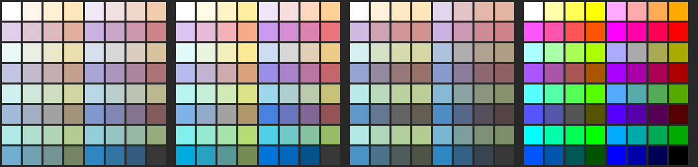

# 37 — Which of the 64 MIP colours look good on the watch

**Question.** A MIP watch shows 64 colours. A `config:` colour setting with
`choices: any` should offer the wearer a list of colours that look good on
the watch: none that look like another one on the list, and none that
look dirty, washed out or muddy. Which colours belong on that list?

**Short answer.** 27 of the 64: the four grays and 23 colours (§5). Every
colour on the list stays at least CIEDE2000 8.5 from every other in a
model of a reflective panel built from a real 64-colour MIP datasheet
(§3). Four groups of colours are dropped, each for a stated reason:

- pastels look off-white;
- muted mixes look gray;
- the dark colours are dim copies of brighter ones;
- dark orange, dark yellow and dark yellow-green look brown or olive, the
  colours people like least (§4).

That leaves 39 candidates. A deduplication pass keeps one colour of every
group that looks alike and drops 16 more (§5). The model is UNVERIFIED
against Garmin's own panel. `face.yaml` in the probe shows all 64 on a
watch, with the dropped ones marked, so the user can check the list by
eye (§6). Research 38 read photos of it on a fēnix 8 Solar: the
linear steps hold, the gamut is the `wider` panel's (about 23% NTSC), and
the 27 hold, with `texas_rose` the weakest and four dropped colours just
over the line.

Probe: `docs/research/probes/mip-colour-appearance/` (`model.py`,
`choose.py`, `gen-face.py`, the images below).

---

## 1. What is known about MIP colour

- **The 64.** Garmin's UX guide lists them: each channel at `00`, `55`,
  `AA` or `FF` (`$CIQ_SDK/doc/docs/User_Experience_Guidelines/
  Incorporating_the_Visual_Design_and_Product_Personalities.html`, "Screen
  Technology"). The same page says MIP "depend[s] on reflecting light, so
  [it looks] brightest outdoors".
- **Garmin's own picks.** `Toybox.Graphics` names 14 colours, all among the
  64 (`$CIQ_SDK/doc/Toybox/Graphics.html`, API 1.0.0):
  - four grays: `FFFFFF`, `AAAAAA`, `555555`, `000000`;
  - `RED FF0000`, `DK_RED AA0000`, `ORANGE FF5500` and `YELLOW FFAA00`;
  - `GREEN 00FF00`, `DK_GREEN 00AA00`, `BLUE 00AAFF`, `DK_BLUE 0000FF`,
    `PURPLE AA00FF` and `PINK FF00FF`.

  Garmin's "yellow" is `FFAA00`, not `FFFF00`. Its "blue" is `00AAFF`, and
  it calls `0000FF` *dark* blue: a hint that pure blue reads dark on these
  panels, which the model reproduces (§3: `0000FF` is L\* 44 to 54, the
  darkest full-strength colour).
- **Community reports**
  ([forums.garmin.com 419763](https://forums.garmin.com/developer/connect-iq/f/discussion/419763/garmin-mip-amoled-palette),
  [1019](https://forums.garmin.com/developer/connect-iq/f/discussion/1019/all-the-colors/1798684)).
  A device screenshot matches the simulator, "it doesn't look the same to
  the human eye" (Forerunner 955). "The MIP display renders colors poorly".
  The look "depends on incident light angle and the backlight". Reds differ
  from model to model. No thread names which colours look alike or bad.
- **Gamut.** JDI's 8-colour MIP modules are quoted at 23% NTSC
  ([Laser Focus World on JDI's modules](https://www.laserfocusworld.com/detectors-imaging/article/16558277/jdi-begins-selling-its-own-ultra-low-power-reflective-color-lcd-modules-for-smartwatches)).
  No figure was found for Garmin's own panels.

## 2. A measured 64-colour MIP panel

The one 64-colour MIP datasheet found with optical figures is Allshore's
ASI-T-213DA1AN/A
([PDF](https://www.allshore.com/portals/0/PDFs/ASIT213DA1ANA.pdf)), a
2.13" 240×320 "MIP TFT / Reflective with Slight Transmissive" module with a
"6-bit Parallel RGB" interface, written "MSB data of 1 line" then "LSB
data". Its typical reflective values:

| | x | y |
|---|---|---|
| Red | 0.381 | 0.289 |
| Green | 0.322 | 0.371 |
| Blue | 0.165 | 0.176 |
| White | 0.291 | 0.288 |

The rest of the table: contrast ratio 25 (15 at least), reflection ratio
8.7%, and NTSC ratio **7.7%** (`model.py` gets 7.7% from the four points,
so the table is self-consistent). It is not Garmin's panel. It is the same
technology, though, and the only measured one. §3 also tries a gamut three
times as large, so the conclusions do not rest on this one module.

## 3. The model

**How a pixel makes four levels.** Each subpixel holds two bits, and its
reflective electrode is split into areas weighted 2:1, so the four levels
reflect 0, ⅓, ⅔ and all of the light. US patent 9,759,964 describes
"an area-based grayscale method for expressing four grayscales with two
bits by weighting areas … by a factor of 2:1". That sentence is quoted
from the search result; the full text returned 403. The steps are linear
in light, not gamma-encoded as on a monitor. UNVERIFIED for Garmin's
panel. It is the mechanism the datasheet's MSB/LSB interface implies, and
§5 shows how much the result depends on it.

**The panel** (`model.py`, `Panel`):

1. Turn each channel's level into the fraction of light its subpixel
   reflects.
2. Raise the black floor to 1/25 of white (the contrast ratio).
3. Mix the result in XYZ from the measured primaries, scaled so that full
   R+G+B gives the measured white.
4. Judge the colour in CIELAB against the panel's own white, which is the
   white the eye adapts to.
5. Measure distances with CIEDE2000 (Sharma, Wu and Dalal, 2005).

Four variants:

| Panel | Primaries | Steps | Contrast |
|---|---|---|---|
| `datasheet` | §2, 7.7% NTSC | linear (area) | 25:1 |
| `wider` | §2 pushed out from white to 23% NTSC | linear | 25:1 |
| `gamma` | §2 | sRGB-like | 25:1 |
| `monitor` | sRGB | sRGB | ∞ (the simulator's view) |



*`appearance.png`: the 64 in the guide's order (white top left, black
bottom right), on each panel left to right, the panel's white drawn as
sRGB white.*

**What the model shows** (`python3 model.py`; L\* lightness, C\*
chroma, both against the panel's white):

- **The middle steps are light.** With linear steps, `555555` is L\* 67
  (36 on a monitor) and `AAAAAA` is 86 (70). Black itself is L\* 24: the
  floor that a 25:1 panel cannot get below. Every colour sits closer to
  white than the simulator suggests. This is the "washed out" look the
  forum reports.
- **Pastels are off-white.** The six colours whose brightest channel is
  `FF` and dimmest `AA` (`FFFFAA`, `FFAAFF`, `FFAAAA`, `AAFFFF`, `AAFFAA`,
  `AAAAFF`) have C\* 5 to 7 on `datasheet` and 9 to 13 on `wider`, about 25
  on a monitor. Next to white they read as a tinted white.
- **Muted mixes are gray.** The six whose brightest channel is `AA` and
  dimmest `55` (`AAAA55`, `AA55AA`, `AA5555`, `55AAAA`, `55AA55`, `5555AA`)
  have C\* 7 to 10 on `datasheet` and 12 to 17 on `wider`, at the lightness
  of the grays.
- **Dark colours are dim siblings.** The six with no channel above `55`
  (`550000`, `555500`, `005500`, `005555`, `000055`, `550055`) sit at
  L\* 38 to 62. Each is the dim copy of its `AA` sibling (`maroon`
  `550000` is ΔE 12 from `AA0000`). They also have little contrast
  against the black most faces draw on.
- **Full-strength colours keep the most chroma.** Every colour with one
  channel at `FF` and another at `00` keeps C\* 19 to 39 on `datasheet` and
  33 to 69 on `wider`. Blue keeps the most (`0000FF`, C\* 39 and 69) and
  yellow the least (`FFFF00`, 24 and 44).
- **One step apart often looks alike.** `FF0000` and `AA0000` are ΔE 8 on
  both linear panels. `00FF00` and `55FF00` are 6.6 and 7.7. `FFFF00`
  and `FFFF55` are 5.4 and 7.0.

## 4. Which colours people dislike

Palmer and Schloss, "An ecological valence theory of human color
preference", *PNAS* 107(19):8877–8882, 2010 (doi 10.1073/pnas.0906172107,
[PMC2889342](https://pmc.ncbi.nlm.nih.gov/articles/PMC2889342)), measured
preference over 32 chromatic colours:

- "dark orange (brown) and dark yellow (olive) were significantly less
  preferred than other oranges and yellows";
- there is "the pronounced minimum around dark yellow" and "a narrow
  trough at chartreuse";
- there is "a broad peak at blue";
- "the s [saturated] colors were preferred to the l [light] and m [muted]
  colors".

That is what "puke-looking" means here: dark orange, dark yellow and dark
yellow-green. On the 64 those are the colours whose hue runs from orange
to yellow-green (20° to 105° in RGB hue) and whose brightest channel is
`AA`: `AA5500` (`rust`), `AAAA00` (`citrus`) and `55AA00`
(`kelly_green`), plus `AAAA55` and `555500`, which the muted and dark rules
already drop. The study's light-and-muted finding agrees with the
pastel and muted rules of §5.

## 5. The selection

`choose.py`, in order:

1. Keep the four grays (all four are Garmin's own constants).
2. Drop the pastels (§3).
3. Drop the muted mixes (§3).
4. Drop the dark colours (§3).
5. Drop brown, olive and dark chartreuse (§4).
6. Deduplicate the 39 left. Take them in priority order: the six
   full-strength hues (`FF0000`, `FFFF00`, `00FF00`, `00FFFF`, `0000FF`,
   `FF00FF`), then the rest of Garmin's constants, then the others by
   chroma on `wider`. Drop any colour within CIEDE2000 9 of one already
   kept, on `wider`.

**The 27**, in the editor picker's order (36's layout: each family light
to dark, its columns running on from the previous family):

| Family | Colours |
|---|---|
| Red | sunset_orange `FF5555`, razzmatazz `FF0055`, red `FF0000`, international_orange `FF5500` |
| Yellow | texas_rose `FFAA55`, web_orange `FFAA00`, yellow `FFFF00` |
| Green | conifer `AAFF55`, green `00FF00`, malachite `00FF55` |
| Cyan | medium_aquamarine `55FFAA`, aqua `00FFFF`, azure_radiance `00AAFF`, pigment_green `00AA55` |
| Blue | neon_blue `5555FF`, navy_blue `0055FF`, blue `0000FF`, electric_indigo `5500FF` |
| Magenta | medium_purple `AA55FF`, pink_flamingo `FF55FF`, electric_violet `AA00FF`, magenta_fuchsia `FF00FF`, indigo `5500AA` |
| Gray | white `FFFFFF`, silver_chalice `AAAAAA`, emperor `555555`, black `000000` |

Twelve of Garmin's 14 constants are on the list. The other two are each
within ΔE 9 of a colour kept before them: `AA0000` (`DK_RED`) of red
(ΔE 8.1), and `00AA00` (`DK_GREEN`) of green (ΔE 8.7). The names are this
project's (`MIP64_NAMED`, `docs/guide/mip-palette.md`).


*`selection.png`: `wider` (left) and a monitor (right); a cross marks a
dropped colour.*

**Dropped as alike**, each with the kept colour it resembles:

- like yellow: `laser_lemon` and `spring_bud`;
- like pink_flamingo: `brilliant_rose`;
- like magenta_fuchsia: `hollywood_cerise` and `dark_magenta`;
- like razzmatazz: `jazzberry_jam`;
- like red: `bright_red`;
- like aqua: `baby_blue`, `medium_green` and `persian_green`;
- like malachite: `screamin_green`;
- like green: `bright_green` and `japanese_laurel`;
- like azure_radiance: `cornflower_blue`;
- like navy_blue: `cobalt`;
- like blue: `midnight_blue`.

**How much rests on the model.** The closest pair on the list is:

| Panel | Closest kept pair | ΔE |
|---|---|---|
| `wider` | white / silver_chalice (the grays are kept by rule) | 8.5 |
| `datasheet` | web_orange / texas_rose | 6.9 |
| `gamma` | green / malachite | 2.2 |
| `monitor` | blue / electric_indigo | 4.1 |

Under both linear panels every pair stays clearly apart. If Garmin's
panel had monitor-like steps (`gamma`), a `55` would be nearly as dark as a
`00`. Then several kept pairs that differ only by a `00` against a `55`
would look alike: green and malachite, red and razzmatazz, magenta and
pink_flamingo. The list would want about six fewer colours. That is the
one assumption worth checking on a watch.

## 6. What this does not settle, and how to check it

- **Garmin's panel is not the datasheet's.** Its gamut, white point and
  steps are unpublished. The list holds across a threefold gamut range;
  the step model is the open question (§5).
- **Taste.** The rules use the published preference evidence. Where the
  user's eye disagrees with the list, the eye wins, and the table in
  `ts/src/palette.ts` is the one place to change it.
- **Check it on a watch.** `gen-face.py` writes `face.yaml`. It is the 64
  in `appearance.png`'s order on black, each a 19 px swatch, with a black
  dot on each colour the list drops. Build and sideload it on a fēnix 8 or
  fr955, then look at it outdoors and under the backlight:

  ```sh
  ./wfb build docs/research/probes/mip-colour-appearance/face.yaml
  ```

  It builds on all three targets (2026-10-24, SDK 9.3.0). Two things decide
  the step model: whether green and malachite (row 7, columns 4 and 3) look
  alike, and whether `555555` (row 6, column 3) looks mid-gray or nearly
  black. **Done: research 38** (`555555` reads mid-gray and the steps are
  linear; green and malachite are 9.6 apart in the best photo, just over
  the threshold).

## 7. How the result is used

A `choices: any` colour setting offers these 27 colours, by name, on both
the native editor and the generated settings menu. It no longer compiles
to `allowAny`, Garmin's own list, which the compiler cannot label or
order. `MIP_RECOMMENDED` in `ts/src/palette.ts` holds the list, in the
order above; `docs/guide/configuration.md` and `docs/guide/mip-palette.md`
document it.
