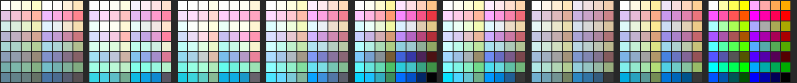

# 38 — The 64 MIP colours on a real watch

**Question.** Research 37 picked the 27 colours a `choices: any` colour
setting offers from a *model* of a reflective MIP panel. It left open how
large Garmin's gamut is, and whether a channel's `55` and `AA` reflect ⅓
and ⅔ of the light (linear area steps) or step like a monitor, in which
case `55` is nearly as dark as `00`. Its probe face draws all 64 on a
watch, and the user photographed it four times, then matched the best
photo's levels to the watch by eye. What do the photos say
about the model, and about the list?

**Short answer.**

- **The steps are linear, as the model assumed.** In every image, the
  model with linear steps orders the swatches by lightness far better than
  monitor-like steps (§3). `555555` reads mid-gray (L\* 72 in the best
  photo; linear predicts 67, monitor-like 42). VERIFIED on a fēnix 8 Solar,
  to the extent a phone photo can show it.
- **The gamut is the `wider` panel's, about 23% of NTSC.** That is the
  panel 37's selection ran on. The best photo, close and square-on, less
  the light the watch glass reflects, matches 25.5% NTSC, and its colour
  differences run at the `wider` model's scale (§4). The user, looking at
  the watch, reports that even that photo is a little paler than the real
  screen; their eye-matched version reads as 32% NTSC (§6).
- **The rules hold.** Pastels are the palest and grayest group, muted mixes
  are gray, dark colours are dim, and the colours the list keeps are the
  most saturated (§5).
- **The 27 hold, with one exception and four near misses** (§6). In the
  best photo every kept pair is at least 9.4 apart, except the grays (kept
  by rule) and `web_orange`/`texas_rose` (7.9). That pair is 5.5 to 7.9
  apart in three of the four photos. Four colours the list drops come in just
  over the line instead: `japanese_laurel` (Garmin's `DK_GREEN`),
  `dark_magenta`, `bright_green` and `cornflower_blue`. Each is 9.4 to 10.4
  from its nearest kept colour, where the model put them 7.7 to 8.9.
- **The eye-matched image keeps the list's structure and moves its edges**
  (§6). With a true black and the user's levels, `texas_rose` clears the
  line and the greens and cyans are far apart. The blue–violet corner
  tightens instead (`blue`/`electric_indigo` 6.8). Three colours the list
  drops clear the line in both the close photo and the eye-matched image:
  `japanese_laurel`, `dark_magenta` and `bright_green`.
- **The backlight changes the picture** (§7). In room light it adds a cool
  cast. Yellows and oranges go peach, reds go pink and greens go mint.
  `aqua` and `azure_radiance` merge, and so do `conifer` and
  `silver_chalice`.

Probe: `docs/research/probes/mip-colour-appearance/` (`measure.py`, the
five images, `photos.png`).

---

## 1. The photos

The user photographed `face.yaml` on their fēnix 8 Solar, in office light,
on 2026-10-26. `face.yaml` is research 37 §6's probe face: the 64 in
`MIP64_NAMED`'s order, white top left and black bottom right, with a black
dot on each colour the list drops.

| Photo | Backlight | Notes |
|---|---|---|
| `photo-ambient.jpg` | off | at an angle, from a distance |
| `photo-backlight-1.jpg` | on | some glare along the top edge |
| `photo-backlight-2.jpg` | on | |
| `photo-close.jpg` | off | close and square-on, cropped to the grid, taken to look as much like the watch as possible; the user notes glass reflection makes it a little paler than the screen |
| `photo-eye.jpg` | off | `photo-close.jpg` with its levels adjusted by the user while looking at the watch: "more or less how I see it" |

The first three are crops around the screen. `photo-close.jpg` is the
photo as the user sent it. Its white swatch has the same colour as the
ambient photo's, (171, 195, 208) against (181, 200, 207) in camera sRGB,
and the backlit ones are far bluer (§7), so its backlight was off.

A phone camera is not a colorimeter: it applies an unknown tone curve,
boosts contrast and saturation, and balances white for the whole scene.
The tests below are built to survive that. The step test uses only the
*order* of lightness, which any monotone tone curve keeps. The colour
comparisons are relative, inside one photo, against that photo's own white
swatch.

**Glass glare.** The cover glass reflects some room light straight to the
camera. That adds the same light to every swatch, which lifts black and
washes every colour toward white. `measure.py` reports each colour figure
twice: as photographed, and less a constant taken off until black is 1/25
of white (the contrast of the measured module, research 37 §2). The order
of lightness, and so the step test, is unchanged by it. Garmin's real
contrast is unpublished. If it is higher than 25:1, the correction is too
small, and the true colours are more saturated still.

Office light is not the light a MIP panel is designed for: it is brightest
outdoors (research 37 §1). The photos say how the colours relate to each
other, not how bright the panel is in the sun.

## 2. Reading the swatches

`measure.py` maps the face's 173 px grid onto each photo with a homography
through the grid's four corners, found by hand. Each swatch is the median
of a ring of points inside it, clear of its edge and of the 6 px dot. The
sample points were drawn over each photo and checked by eye before any
numbers were read.

*`photos.png`, left to right: the ambient photo, the two backlit photos, the
close photo and the eye-matched image, each scaled in linear light so its
white swatch draws white; the close photo again, less the glare; then the
model's `datasheet`, `wider` and monitor panels. The close photo less the
glare and the `wider` model look alike; the eye-matched image is more
saturated still.*

## 3. The steps

The two step models disagree on the lightness order of many pairs. Take
`555555` and `00AA00`: with linear steps the gray is lighter, and with
monitor-like steps the green is. For every such pair whose camera
lightness differs by more than 3%, `measure.py` checks which order the
photo shows:

| Photo | Linear wins | Monitor-like wins | Too close | Kendall τ, linear / monitor-like |
|---|---|---|---|---|
| ambient | 116 | 47 | 16 | 0.747 / 0.677 |
| backlight 1 | 129 | 35 | 15 | 0.795 / 0.694 |
| backlight 2 | 144 | 22 | 13 | 0.822 / 0.694 |
| close | 131 | 31 | 17 | 0.846 / 0.748 |
| eye-matched | 137 | 31 | 11 | 0.855 / 0.751 |

The minority votes are what uneven light across the screen, glare and
viewing angle produce: the white swatch sits in a corner and black in the
opposite one.

Fitting the two middle steps freely gives the step values whose predicted
order best matches each photo. The best fits are `55` at 0.28 to 0.36 and
`AA` at 0.64 to 0.82, against ⅓ and ⅔ for area steps and 0.09 and 0.40
for monitor-like ones. The close photo pins it best: `55` at 0.34 to 0.44
and `AA` at 0.60 to 0.74 (every fit within 0.01 of its best τ). Every
photo excludes monitor-like steps. The close photo puts `55` at or just
above area steps' ⅓, and `AA` around their ⅔.

The grays, as L\* against the photo's white:

| | `000000` | `555555` | `AAAAAA` | `FFFFFF` |
|---|---|---|---|---|
| ambient photo | 35 | 62 | 94 | 100 |
| close photo | 41 | 75 | 95 | 100 |
| close photo, less the glare | 24 (set) | 72 | 94 | 100 |
| eye-matched | 1 | 59 | 92 | 100 |
| model, linear steps | 24 | 67 | 86 | 100 |
| model, monitor-like steps | 24 | 42 | 71 | 100 |

## 4. The gamut

`measure.py` compares each photo's chroma (against its white) with the
model's, colour by colour, and finds the gamut whose median chroma matches:

| Photo | vs `datasheet` (7.7%) | vs `wider` (23%) | Matching gamut | Less the glare |
|---|---|---|---|---|
| ambient | 1.27× | 0.73× | 12.5% NTSC | 15.0% |
| backlight 1 | 1.43× | 0.82× | 15.5% | 18.5% |
| backlight 2 | 1.50× | 0.85× | 17.0% | 23.0% |
| close | 1.60× | 0.92× | 20.0% | 25.5% |
| eye-matched | 2.05× | 1.19× | 32.0% | (no glare left) |

The close photo is the one to trust. It was taken square-on, so the
panel's viewing angle and the glass's reflection cost it the least; the
ambient photo, at an angle and from a distance, loses the most. Less the
glare, the close photo matches 25.5%, and the user reports the screen is
more saturated than the photo. A phone's colour boost pushes the other
way, so the two roughly cancel. The `wider` panel (23%, JDI's quoted figure
for its 8-colour MIP modules) is the right model for Garmin's panel, and
the `datasheet` module (7.7%) is far too pale.

A second check agrees. Across all pairs of candidate colours, the close
photo's colour differences, less the glare, run at 1.01 times the `wider`
model's. So 37's threshold of 9 on `wider` means the same here.

## 5. The rules

Mean L\* and C\* of each of `choose.py`'s groups, against the photo's white:

| Group | ambient | backlight 1 | backlight 2 | close | close, less the glare |
|---|---|---|---|---|---|
| pastel | 97 / 9.9 | 99 / 8.1 | 102 / 9.3 | 98 / 11.7 | 98 / 12.8 |
| muted | 77 / 12.9 | 89 / 15.6 | 93 / 16.6 | 84 / 14.1 | 82 / 15.8 |
| dark | 48 / 12.2 | 65 / 31.3 | 70 / 30.5 | 60 / 21.7 | 53 / 27.9 |
| brown/olive | 79 / 24.2 | 89 / 20.0 | 95 / 25.0 | 82 / 20.3 | 80 / 25.6 |
| the rest (where the 27 come from) | 74 / 26.2 | 87 / 30.1 | 89 / 31.6 | 83 / 33.9 | 81 / 38.7 |

(An L\* above 100 is a swatch the camera saw brighter than the white one,
which sits in a corner.)

- **Pastels are off-white**: the palest group and the least colourful, in
  every photo. VERIFIED.
- **Muted mixes are gray**: well under half the chroma of the rest in the
  close photo. VERIFIED.
- **Dark colours are dim** (L\* 48 to 60 with the backlight off, against
  74 to 83 for the rest). VERIFIED. In the close photo they keep some
  colour (C\* 22 to 28), so they read as dark colours rather than gray.
  Under the backlight they gain chroma (C\* 26 to 45 for `maroon`, `navy`,
  `mosque` and `tyrian_purple`). The mechanism is UNVERIFIED. One
  possibility is that the backlight's window does not split 2:1 the way the
  reflective electrode does. The rule drops them for being dim copies of a
  brighter sibling and for their low contrast on black, and both still
  hold.
- **Brown and olive** are as colourful as the rest by chroma. They were
  dropped for their hue, on preference evidence (research 37 §4), not for
  chroma, and the photos neither support nor contradict that.

## 6. The list

`measure.py` lists the closest pairs among the 27, as CIEDE2000 between
the photo's colours, then reruns `choose.py`'s deduplication on them. The
threshold is 37's 9, scaled by the photo's ΔE against the `wider` model's.
The close photo, less the glare, at a threshold of 9.1:

- **Closest kept pairs**: white/silver_chalice 4.7 (the grays are kept by
  rule), web_orange/texas_rose 7.9, magenta_fuchsia/electric_violet 9.4,
  green/malachite 9.6, malachite/medium_aquamarine 10.0. Every other pair
  is further apart.
- **The rerun drops** `texas_rose` (like `web_orange`) and `conifer`. It
  drops `conifer` only because `spring_bud` is now kept ahead of it, on
  higher chroma, and the two are 8.0 apart. `conifer` is 13.4 from every
  other colour on the list, so that is a swap, not a crowded colour.
- **The rerun adds**, each with its nearest kept colour in the photo
  (and in the `wider` model, which dropped them):

  | Colour | Nearest kept | Photo ΔE | Model ΔE | Where on `face.yaml` |
  |---|---|---|---|---|
  | `japanese_laurel` `00AA00` (Garmin's `DK_GREEN`) | green | 9.8 | 8.7 | row 7, column 8 |
  | `dark_magenta` `AA00AA` | electric_violet | 10.0 | 8.3 | row 4, column 6 |
  | `bright_green` `55FF00` | conifer | 10.4 | 7.7 | row 5, column 4 |
  | `cornflower_blue` `55AAFF` | azure_radiance | 9.4 | 8.9 | row 5, column 5 |
  | `spring_bud` `AAFF00` | conifer | 8.0 | 6.8 | row 3, column 4 |

The other photos mostly agree on `web_orange`/`texas_rose`: the pair is
5.5 to 7.9 apart in three of the four photos (8.8 in the first backlit
one), and `texas_rose` drops in three of the four reruns. They do not
agree with the close photo on the green–cyan corner. In the ambient and backlit photos, `green`,
`malachite`, `pigment_green`, `aqua` and `azure_radiance` crowd within 2
to 7 of each other, and their reruns drop `malachite`, `pigment_green` and
`azure_radiance`. Those three photos have the paler colours of §4: at an
angle, from a distance or under the backlight, the greens and cyans wash
toward each other. Square-on, with the backlight off, they separate.

### The eye-matched image

`photo-eye.jpg` is the close photo with its levels set by the user while
comparing it with the watch, which makes it the eye's own rendering of the
screen. Its black is a true black (L\* 1), as black looks on the watch
in context, so no glare correction applies. It is the most saturated
reading: 1.19 times `wider`, a gamut of 32% NTSC. The steps are linear
again: 137 pairs against 31, a best fit of `55` at 0.38 and `AA` at 0.68,
and `555555` at L\* 59, where linear steps with a true black predict 64
and monitor-like ones 36.

Because the image stands for what the eye sees, 37's threshold of 9
applies to it unscaled: CIEDE2000 is a perceptual scale.

- **Closest kept pairs**: white/silver_chalice 5.9, blue/electric_indigo
  6.8, navy_blue/neon_blue 8.3, azure_radiance/navy_blue 9.8,
  magenta_fuchsia/electric_violet 10.1, aqua/medium_aquamarine 10.4,
  web_orange/texas_rose 10.6. Every other pair is further apart; green and
  malachite are 13.7.
- **The rerun at 9 drops** `electric_indigo` (like `blue`) and `neon_blue`
  (like `navy_blue`), and **adds** `bright_red` (12.4 from `red`),
  `japanese_laurel` (12.9 from `pigment_green`), `midnight_blue`,
  `dark_magenta` (12.1 from `electric_violet`), `jazzberry_jam`,
  `bright_green` (12.9 from `green`) and `screamin_green`: 32 colours.
  Scaled to the image's spread instead (1.15 times `wider`, a threshold of
  10.3), it also drops `electric_violet`, `navy_blue` and `indigo`.
- `cornflower_blue` stays out (8.9 from `azure_radiance`), and so does
  `spring_bud` (6.5 from `yellow`), so `conifer` keeps its place.

With a true black the dark saturated colours separate from their bright
siblings, which is why the `AA` versions of red, green and magenta come
in. The darkest blues move toward each other: `blue` is L\* 50 and
`electric_indigo` 45, both strongly coloured.

### What the images support

The list's structure is right. Its edges depend on how the screen is
seen, and the two square-on readings (the close photo less the glare, and
the eye-matched image) agree on some and not others:

- **Add `japanese_laurel`, `dark_magenta` and `bright_green`.** Both
  readings put each clear of every kept colour (9.8 to 13.8).
- **`texas_rose` is borderline**: 7.9 from `web_orange` in the close
  photo, 10.6 in the eye-matched image.
- **Only the eye-matched image** drops `electric_indigo` and `neon_blue`
  and adds `bright_red`, `midnight_blue`, `jazzberry_jam` and
  `screamin_green`.
- **Only the close photo** adds `cornflower_blue`, and swaps `conifer`
  for `spring_bud`.

A camera does not see hue as the eye does, so where the two disagree, the
eye-matched image is the better witness. The user's levels, though, are
one adjustment by eye on one phone's screen.

## 7. The backlight

The backlight is a cool white compared with the office light. The white
swatch is camera sRGB (181, 200, 207) and (171, 195, 208) without it, and
(168, 212, 253) and (151, 198, 254) with it, while the wrist around the
watch keeps its colour. In the room's light the backlit screen therefore
looks blue. Balanced to its own white (§5), colours gain some chroma, but
the warm end loses it:

- `yellow` turns from hue 85° to about 62° (peach), and `web_orange` from
  61° to about 46°;
- `conifer` drops to C\* 9 to 12 and sits 4.4 from `silver_chalice`;
- `aqua` and `azure_radiance` merge (1.9 and 3.4).

The steps stay linear under the backlight (§3). A face that relies on
yellow against orange, or on a yellow-green, reads worse with the light on.
The compiler cannot change that, and the 27 are chosen for ambient light.

## 8. What this does not settle

- **One watch, one camera, office light.** The fēnix 8 Solar is the only
  panel photographed. `fr955` and the other MIP devices may differ, and
  sunlight is MIP's main case.
- **The glare correction rests on a 25:1 contrast** that is the measured
  module's, not Garmin's.
- **Hue.** A camera's rendering of hue from an LCD's narrow primaries is not
  the eye's, so the hues in §6 and §7 are indicative.
- **The list itself.** Research 37's 27 are unchanged by this record. §6
  names what each reading would change.
