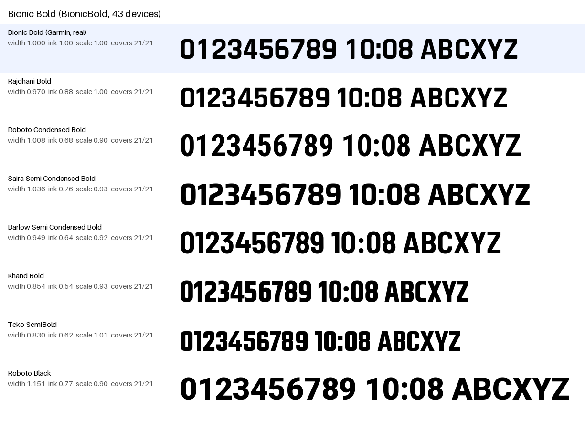
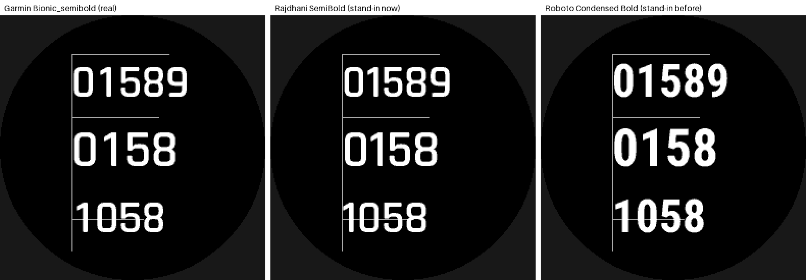
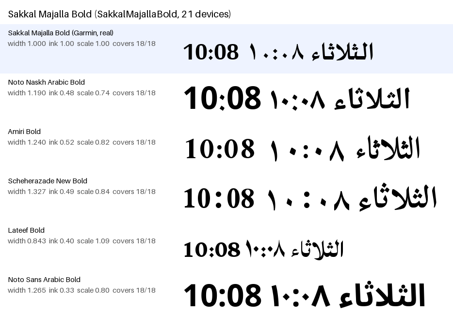
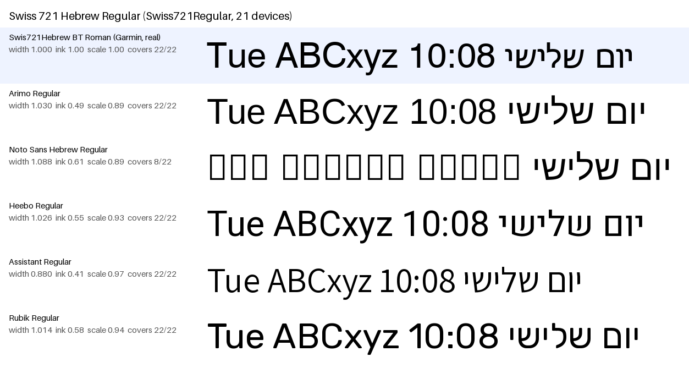

# 40 — A free stand-in for every device-resident scalable face

**Question.** Every scalable (vector) face a watch publishes needs a free,
redistributable file that draws like it, so that `fallback: auto` (plan 40)
can bake a sheet for a watch that lacks the face, and a preview without
Garmin's own fonts draws the right letterforms. Which faces are there,
which of them are free fonts Garmin ships unchanged, which are Garmin's
builds of a free font, and what is the closest free face for the ones that
are proprietary?

**Short answer.** The SDK 9.3.0 device reference lists 32 scalable face
names in 17 families on the 58 face-capable devices that publish any
(§1). Every one now resolves to a pinned, licensed file in
`ts/src/data/font-registry.json` (§3), and `unmapped` is empty.

- **Six are byte-identical** to a free file (Noto Naskh Arabic, Noto Sans
  Hebrew, Noto Sans Armenian, Regular and Bold each, from the archived
  `googlefonts/noto-fonts` repository at two pinned commits), and Roboto
  Black was already. Noto Sans SC Medium and Pridi Regular are the same cut
  (same advances and bounding boxes on every shared glyph) as a free file.
  VERIFIED (§2).
- **Bionic is not proprietary.** Bionic Bold, SemiBold and Medium are
  Rajdhani Bold, SemiBold and Medium (OFL, Indian Type Foundry) with the
  ten digits and `+` redrawn to one tabular width. Every other glyph has
  Rajdhani's outline point for point; the files carry Rajdhani's version
  string, vendor id and OFL notice. VERIFIED (§2.1). The registry now maps
  every Bionic name, scalable and bitmap, to Rajdhani (`family`). It mapped
  it to Roboto Condensed Bold before (research 10 §9).
- **Two faces are proprietary**, and take substitutes chosen by look
  (§4): Sakkal Majalla (Roman, Bold) → **Amiri**, and Swis721Hebrew BT
  (Regular, Bold) → **Arimo**.
- **The whole registry downloads 33.7 MB** (27 direct files, 23.7 MB; two
  archives, 9.8 MB; licence texts, 0.1 MB). 20.8 MB of that is new, and
  8.4 MB of it is Noto Sans SC. `tools/setup-env.sh` now installs all of it
  (§5).

Machine: the SDK 9.3.0 device reference at `.cache/device-reference/`
(178 devices), the user's own Garmin font files at
`~/.Garmin/ConnectIQ/Fonts` (copied from the SDK Manager's `Fonts`,
`vendor/fonts/`), surveyed 2026-11-06. Every script and output named
here is in `docs/research/data/40-vector-face-stand-ins/`.

## 1. The survey

`survey.mjs` reads every device page's `fonts[<language group>].scalable`
block (the `face` family column and the `font` file stem), counting
watch-face-capable devices (an `app_types` entry `Watch Face`). Its output
(`survey.txt`), VERIFIED:

> 178 devices, 150 watch-face-capable, 58 publish a scalable face, 32 face names

| face name | family | file stems (devices) | devices |
|---|---|---|---|
| `KosugiRegular` | MotoyaLCedar | `Kosugi-Regular-3` (21), `Kosugi-Regular-2` (20), `Kosugi-Regular-Outdoor` (14), `Kosugi-Regular` (2) | 57 |
| `NotoSansSCMedium` | Noto Sans SC | `NotoSansSC-Medium-3` (21), `NotoSansSC-Medium-2` (20), `NotoSansSC-Medium-Outdoor` (14), `NotoSansSC-Medium` (2) | 57 |
| `RobotoCondensedBold` | Roboto Condensed | `RobotoCondensed-Bold` (55) | 55 |
| `RobotoCondensedRegular` | Roboto Condensed | `RobotoCondensed-Regular` (55) | 55 |
| `BionicBold` | Bionic | `Bionic_Bold` (22), `Bionic_Bold_Number_Only` (21) | 43 |
| `NotoNaskhArabicRegular` | Noto Naskh Arabic | `NotoNaskhArabic-Regular` (36) | 36 |
| `NotoSansHebrewRegular` | Noto Sans Hebrew | `NotoSansHebrew-Regular` (36) | 36 |
| `NotoNaskhArabicBold` | Noto Naskh Arabic | `NotoNaskhArabic-Bold` (34) | 34 |
| `NotoSansArmenianBold` | Noto Sans Armenian | `NotoSansArmenian-Bold` (34) | 34 |
| `NotoSansArmenianRegular` | Noto Sans Armenian | `NotoSansArmenian-Regular` (34) | 34 |
| `NotoSansHebrewBold` | Noto Sans Hebrew | `NotoSansHebrew-Bold` (34) | 34 |
| `RobotoRegular` | Roboto | `Roboto-Regular` (32) | 32 |
| `NanumGothicBold` | NanumGothic | `NanumGothic-Bold` (30) | 30 |
| `PridiRegular` | Pridi | `Pridi-Regular` (30) | 30 |
| `RobotoItalic` | Roboto Wide | `Roboto-Italic` (28) | 28 |
| `NanumGothicRegular` | NanumGothic | `NanumGothic-Regular` (21) | 21 |
| `PridiRegularGarmin` | Pridi | `Pridi-Regular_Garmin` (21) | 21 |
| `SakkalMajallaBold` | Sakkal Majalla Unicode | `sakkal_majalla_bold` (21) | 21 |
| `SakkalMajallaRoman` | Sakkal Majalla Unicode | `sakkal_majalla_roman` (21) | 21 |
| `Swiss721Bold` | Swis721Hebrew BT | `swiss_721_bd` (21) | 21 |
| `Swiss721Regular` | Swis721Hebrew BT | `swiss_721_reg` (21) | 21 |
| `BionicMedium` | Rajdhani | `Bionic_Medium` (14) | 14 |
| `RobotoMedium` | Roboto | `Roboto-Medium-Outdoor` (14) | 14 |
| `YantramanavRegular` | Yantramanav | `Yantramanav-Regular` (7) | 7 |
| `NanumGothicExtraBold` | NanumGothic | `NanumGothic-ExtraBold` (6) | 6 |
| `PridiSemiBoldGarmin` | Pridi | `Pridi-SemiBold_Garmin` (6) | 6 |
| `RobotoCondensedRegularItalic` | Roboto Condensed | `RobotoCondensed-RegularItalic` (6) | 6 |
| `BionicSemiBold` | Bionic | `Bionic_semibold` (5) | 5 |
| `ExoSemiBold` | Exo | `Exo-SemiBold` (3) | 3 |
| `BionicSemibold` | Bionic | `Bionic_semibold` (1) | 1 |
| `RobotoBlack` | Roboto | `Roboto-Black` (1) | 1 |
| `TomorrowBold` | Tomorrow | `Tomorrow-Bold` (1) | 1 |

The 17 families: Bionic, Exo, MotoyaLCedar, NanumGothic, Noto Naskh Arabic,
Noto Sans Armenian, Noto Sans Hebrew, Noto Sans SC, Pridi, Rajdhani, Roboto,
Roboto Condensed, Roboto Wide, Sakkal Majalla Unicode, Swis721Hebrew BT,
Tomorrow, Yantramanav. `BionicSemibold` is a casing variant of `BionicSemiBold` on one
device (same file).

The user's font root holds 34 of the 37 distinct files: everything but
`Exo-SemiBold`, `Tomorrow-Bold` and `Yantramanav-Regular` (no installed
device uses them).

## 2. What each Garmin file is

Two checks, both VERIFIED for every file present.

- `names.py` reads the `name` table (family, style, version, copyright,
  licence) and the `OS/2` vendor. Its output for every Garmin file, and for
  the three Rajdhani files, is `names.txt`.
- `identity.py` compares a Garmin file with the free file over the
  codepoints both map: the advance (to 0.002 em), the bounding box (to
  0.01 em) and the outline point for point. `identity.sh` runs it for
  every pair. Its output is `identity.txt`, summarised here:

| Garmin file | free file | result | match |
|---|---|---|---|
| `NotoNaskhArabic-Regular`, `-Bold` | `noto-fonts` @ `62b3177` `hinted/` | byte-identical (v1.06) | exact |
| `NotoSansHebrew-Regular`, `-Bold` | `noto-fonts` @ `62b3177` `hinted/` | byte-identical (v1.04) | exact |
| `NotoSansArmenian-Regular`, `-Bold` | `noto-fonts` @ `8ef14e6` `hinted/` | byte-identical (v2.040) | exact |
| `Roboto-Black` | Roboto v2.138 zip | byte-identical | exact |
| `NotoSansSC-Medium` (and `-2`, `-3`, `-Outdoor`) | `noto-cjk` @ `v1.004` `NotoSansSC-Medium.otf` | Garmin's are TrueType conversions of this CFF file: every shared glyph has the same advance and bounding box (4 of 30,788 differ in the base file, 2 in the others); `-2`/`-3`/`-Outdoor` drop about 600 glyphs | exact (same cut) |
| `Pridi-Regular` | `google/fonts` Pridi Regular | every outline identical, not byte-identical | exact (same cut) |
| `Pridi-Regular_Garmin` | the same | 20 Thai glyphs and the tone marks redrawn | family |
| `Pridi-SemiBold_Garmin` | Pridi SemiBold | 7 Thai glyphs redrawn | family |
| `Kosugi-Regular`, `-3` | `google/fonts` Kosugi Regular v4.002 | every shared advance and bounding box the same (the family name inside is `MotoyaLCedar`, Kosugi's original) | exact cut |
| `Kosugi-Regular-2`, `-Outdoor` | the same | also redraw the 58 half-width katakana | family |
| `NanumGothic-Regular`, `-Bold`, `-ExtraBold` | `google/fonts` NanumGothic v3.020 | same advances and outlines, but every glyph moved down (0.044 em Regular, 0.051 em Bold), `hhea` changed, and about 5,600 extra codepoints | family |
| `Bionic_Bold`, `_semibold`, `_Medium` | Rajdhani Bold, SemiBold, Medium | §2.1 | family |
| `RobotoCondensed-RegularItalic` | Roboto Condensed Italic v2.138 | Garmin's is Google's v2.137 with widened tabular digits (0.484 em, against 0.479); 99% of bounding boxes agree | family |
| `Roboto-Italic` ("Roboto Wide") | Roboto Italic v2.138 | Garmin's widened italic: digits 0.562 em, against 0.545 | family |
| `RobotoCondensed-Bold`, `-Regular` | Roboto Condensed v2.138 | the SDK Manager's copy is the 2014 v2.000980 build: 95% of advances agree, and every ASCII letter and digit | exact (kept; the same design) |
| `Roboto-Medium-Outdoor` | Roboto Medium v2.138 | v2.136: 98% of advances agree | exact (kept) |
| `sakkal_majalla_*` | none | Sakkal Design, © 2004, no licence string | substitute (§4.2) |
| `swiss_721_*` | none | Bitstream, © 1990–2001, no licence string | substitute (§4.3) |

`Exo-SemiBold`, `Tomorrow-Bold` and `Yantramanav-Regular` are not on this
machine. Tomorrow Bold v2.002 is the face's only free release: `exact`,
UNVERIFIED by bytes. Exo is `family` because Exo exists in two spacings
(Exo 1.0 and its 2016 refresh, which Google Fonts serves) and which one
Garmin ships is UNVERIFIED. Yantramanav keeps the `exact` research 10 gave it.

Research 10 called the Roboto Condensed files "byte-identical" on the
strength of `fr955`'s `simulator.json`. The SDK Manager's own copies hash
differently (VERIFIED above), as research 10 §9 itself noted. The registry
note now says what is true; the match stays `exact`, since the letterforms
and ASCII advances are the same.

### 2.1 Bionic is Rajdhani with tabular digits

| | Bionic Bold | Rajdhani Bold |
|---|---|---|
| family / style | Bionic / Bold (full name "Bionici Bold") | Rajdhani / Bold |
| version string | `Version 1.201;PS 1.0;hotconv 1.0.78;makeotf.lib2.5.61930; ttfautohint (v1.1) -l 7 -r 28 -G` | the same |
| glyphs, units per em | 1100, 1000 | 1100, 1000 |
| `OS/2` vendor | `ITFO` (Indian Type Foundry) | `ITFO` |
| licence string | SIL Open Font License 1.1 | the same |
| shared glyphs with the same outline | 97.4% (all but `0`–`9` and `+`) | |
| digit advances | all 0.516 em; outlines 0.436 em wide (`1` 0.246) | proportional, 0.334 (`1`) to 0.542 (`8`) |

Bionic SemiBold (`Bionic_semibold`, "Copyright (c) 2021 by Garmin", built
in FontCreator) is Rajdhani SemiBold the same way: 97.8% of outlines
identical, and digits at 0.516 em (`9` at 0.515). Bionic Medium is Rajdhani Medium,
digits 0.500 em. The reference's own `face` column already reads
`Rajdhani` for `Bionic_Medium`. `Bionic_Bold_Number_Only` is the digits,
`+` and a few signs of Bionic Bold. All VERIFIED (`identity.txt`).

So the stand-in is the free font Bionic was built from, and the match is
`family` (Garmin's tweaked build of a free font). Only the digits differ,
and in two ways. The outlines are close in shape: their bounding-box widths
are within 0.05 em, with `4` and `7` differing most. The advances differ more:
Rajdhani's digits are proportional, where Bionic's are tabular.

## 3. The mapping

`mapping.mjs` prints the registry's answer for every face in the
reference. The face name, which is what `fallback: auto` resolves, and every
file stem the reference lists for it resolve to the same key. VERIFIED,
and held by `ts/test/font-registry.test.ts`.

| face name | devices | key | match | licence | stand-in file | size |
|---|---|---|---|---|---|---|
| `KosugiRegular` | 57 | `kosugi-regular` | family | Apache-2.0 | Kosugi-Regular.ttf | 2235 KB |
| `NotoSansSCMedium` | 57 | `noto-sans-sc-medium` | exact | OFL-1.1 | NotoSansSC-Medium.otf | 8201 KB |
| `RobotoCondensedBold` | 55 | `roboto-condensed-bold` | exact | Apache-2.0 | RobotoCondensed-Bold.ttf | 340 KB |
| `RobotoCondensedRegular` | 55 | `roboto-condensed-regular` | exact | Apache-2.0 | RobotoCondensed-Regular.ttf | 337 KB |
| `BionicBold` | 43 | `rajdhani-bold` | family | OFL-1.1 | Rajdhani-Bold.ttf | 391 KB |
| `NotoNaskhArabicRegular` | 36 | `noto-naskh-arabic-regular` | exact | OFL-1.1 | NotoNaskhArabic-Regular.ttf | 246 KB |
| `NotoSansHebrewRegular` | 36 | `noto-sans-hebrew-regular` | exact | OFL-1.1 | NotoSansHebrew-Regular.ttf | 26 KB |
| `NotoNaskhArabicBold` | 34 | `noto-naskh-arabic-bold` | exact | OFL-1.1 | NotoNaskhArabic-Bold.ttf | 219 KB |
| `NotoSansArmenianBold` | 34 | `noto-sans-armenian-bold` | exact | OFL-1.1 | NotoSansArmenian-Bold.ttf | 29 KB |
| `NotoSansArmenianRegular` | 34 | `noto-sans-armenian-regular` | exact | OFL-1.1 | NotoSansArmenian-Regular.ttf | 29 KB |
| `NotoSansHebrewBold` | 34 | `noto-sans-hebrew-bold` | exact | OFL-1.1 | NotoSansHebrew-Bold.ttf | 27 KB |
| `RobotoRegular` | 32 | `roboto-regular` | exact | Apache-2.0 | Roboto-Regular.ttf | 341 KB |
| `NanumGothicBold` | 30 | `nanumgothic-bold` | family | OFL-1.1 | NanumGothic-Bold.ttf | 2025 KB |
| `PridiRegular` | 30 | `pridi-regular` | exact | OFL-1.1 | Pridi-Regular.ttf | 217 KB |
| `RobotoItalic` | 28 | `roboto-italic` | family | Apache-2.0 | Roboto-Italic.ttf | 366 KB |
| `NanumGothicRegular` | 21 | `nanumgothic-regular` | family | OFL-1.1 | NanumGothic-Regular.ttf | 2007 KB |
| `PridiRegularGarmin` | 21 | `pridi-regular-garmin` | family | OFL-1.1 | Pridi-Regular.ttf | 217 KB |
| `SakkalMajallaBold` | 21 | `amiri-bold` | substitute | OFL-1.1 | Amiri-Bold.ttf | 404 KB |
| `SakkalMajallaRoman` | 21 | `amiri-regular` | substitute | OFL-1.1 | Amiri-Regular.ttf | 421 KB |
| `Swiss721Bold` | 21 | `arimo-bold` | substitute | OFL-1.1 | Arimo-Bold.ttf | 474 KB |
| `Swiss721Regular` | 21 | `arimo-regular` | substitute | OFL-1.1 | Arimo-Regular.ttf | 467 KB |
| `BionicMedium` | 14 | `rajdhani-medium` | family | OFL-1.1 | Rajdhani-Medium.ttf | 375 KB |
| `RobotoMedium` | 14 | `roboto-medium` | exact | Apache-2.0 | Roboto-Medium.ttf | 343 KB |
| `YantramanavRegular` | 7 | `yantramanav-regular` | exact | OFL-1.1 | Yantramanav-Regular.ttf | 150 KB |
| `NanumGothicExtraBold` | 6 | `nanumgothic-extrabold` | family | OFL-1.1 | NanumGothic-ExtraBold.ttf | 2063 KB |
| `PridiSemiBoldGarmin` | 6 | `pridi-semibold-garmin` | family | OFL-1.1 | Pridi-SemiBold.ttf | 215 KB |
| `RobotoCondensedRegularItalic` | 6 | `roboto-condensed-italic` | family | Apache-2.0 | RobotoCondensed-Italic.ttf | 366 KB |
| `BionicSemiBold` | 5 | `rajdhani-semibold` | family | OFL-1.1 | Rajdhani-SemiBold.ttf | 381 KB |
| `ExoSemiBold` | 3 | `exo-semibold` | family | OFL-1.1 | Exo-SemiBold.ttf | 135 KB |
| `BionicSemibold` | 1 | `rajdhani-semibold` | family | OFL-1.1 | Rajdhani-SemiBold.ttf | 381 KB |
| `RobotoBlack` | 1 | `roboto-black` | exact | Apache-2.0 | Roboto-Black.ttf | 343 KB |
| `TomorrowBold` | 1 | `tomorrow-bold` | exact | OFL-1.1 | Tomorrow-Bold.ttf | 57 KB |

How the registry is shaped:

- **One key per file and match.** Two keys share a file only where the
  match differs between face names: `pridi-regular` (exact) and
  `pridi-regular-garmin` (family). Kosugi's one face name spans an exact
  cut (`-3`, plain) and a tweaked one (`-2`, `-Outdoor`, 34 of the 57
  devices), so its single key says `family`, and the note gives the split.
- **What changed for names that resolved before.**
  - `RobotoCondensed-RegularItalic` / `RobotoCondensedRegularItalic` resolved
    to the upright `roboto-condensed-regular`. They now resolve to
    `roboto-condensed-italic`, a new file from the same Roboto archive.
  - Every Bionic name moves to Rajdhani (§4.1): `Bionic_Bold`, `BionicBold`
    and `Bionic_Bold_Number_Only` to `rajdhani-bold`; `Bionic_semibold`,
    `BionicSemiBold` and `BionicSemibold` to `rajdhani-semibold`; the bitmap
    `*_BIONIC_SEMI_BOLD_NUMBER_*` (a new pattern) to `rajdhani-semibold`.
    `bionic-substitute`, the key behind the `BIONIC` pattern and the `faces`
    entry `Bionic`, now has Rajdhani Bold as its source and `family` as its
    match.
  - `bionic-cond-substitute` (Bionic Cond) stays Roboto Condensed Bold:
    Rajdhani has no condensed cut.
  - Every other existing name resolves as before.
- **`roboto-italic`'s match** moves from `exact` to `family`, because of
  Garmin's widened build (§2). The key does not change.
- **`faces`** gains the new families, for the device reference's `face`
  column.
- **`unmapped` is empty.** Nothing is left unresolvable.

The sources added, printed from the registry (VERIFIED by downloading each
one, hashing it and installing it, §5):

| source | URL (pinned) | bytes | SHA-256 | licence |
|---|---|---|---|---|
| `rajdhani-bold` | https://raw.githubusercontent.com/google/fonts/a54f7446f84a1125ef6bf08baa46f3639e8905e0/ofl/rajdhani/Rajdhani-Bold.ttf | 400680 | `691470dd3286a14e9677940d0bf75796179841ba5215cbda1a2c8910a3226afd` | OFL-1.1 |
| `rajdhani-semibold` | https://raw.githubusercontent.com/google/fonts/a54f7446f84a1125ef6bf08baa46f3639e8905e0/ofl/rajdhani/Rajdhani-SemiBold.ttf | 390340 | `94bbd25a18ca665999feb05a537de9fd2b860dcfb78bbe9ca00270825bf235da` | OFL-1.1 |
| `roboto-condensed-italic` | https://github.com/googlefonts/roboto/releases/download/v2.138/roboto-unhinted.zip (member `RobotoCondensed-Italic.ttf`) | 375192 | `a20745044624fe4e19ee2d5ddb6fd785a62cd9fd86a773fe719388e9ddfe73af` | Apache-2.0 |
| `noto-sans-sc-medium` | https://raw.githubusercontent.com/notofonts/noto-cjk/f36eda03dfa5582a6d49abbfb5c83d0209584158/NotoSansSC-Medium.otf | 8397956 | `5329caacebabedc6473d4db04b4edc35b8f5c5d6ca762a7350593710a7c8636c` | OFL-1.1 |
| `noto-naskh-arabic-regular` | https://raw.githubusercontent.com/googlefonts/noto-fonts/62b31777e4062b8700ca6bf6f8eda6067247dea2/hinted/NotoNaskhArabic-Regular.ttf | 252088 | `a0bc0de437cc88f0ad0eed9c8e9fb9d7de41fd3da87ed7f4ac1cd0143151e4fa` | OFL-1.1 |
| `noto-naskh-arabic-bold` | https://raw.githubusercontent.com/googlefonts/noto-fonts/62b31777e4062b8700ca6bf6f8eda6067247dea2/hinted/NotoNaskhArabic-Bold.ttf | 224128 | `f61cabfecaa1b80f9b8778e6b099ca1fa73b64cb9944119596b749f2e55b6a98` | OFL-1.1 |
| `noto-sans-hebrew-regular` | https://raw.githubusercontent.com/googlefonts/noto-fonts/62b31777e4062b8700ca6bf6f8eda6067247dea2/hinted/NotoSansHebrew-Regular.ttf | 26912 | `f51d96a6e503d195320fffbdd6e76aceefb7d88839e2cf0df75fb74449e18abd` | OFL-1.1 |
| `noto-sans-hebrew-bold` | https://raw.githubusercontent.com/googlefonts/noto-fonts/62b31777e4062b8700ca6bf6f8eda6067247dea2/hinted/NotoSansHebrew-Bold.ttf | 27216 | `bc929b4e85dc3bc437348d438ba226ac6e6c7d1dc8c5c70dc10d86236c8fa36f` | OFL-1.1 |
| `noto-sans-armenian-regular` | https://raw.githubusercontent.com/googlefonts/noto-fonts/8ef14e6c606a7a0ef3943b9ca01fd49445620d79/hinted/NotoSansArmenian-Regular.ttf | 29588 | `9dfe2abaf9d2db7200b8ebbc48961717ff0ba30845809a0d93f2dfeba0bb7e11` | OFL-1.1 |
| `noto-sans-armenian-bold` | https://raw.githubusercontent.com/googlefonts/noto-fonts/8ef14e6c606a7a0ef3943b9ca01fd49445620d79/hinted/NotoSansArmenian-Bold.ttf | 29548 | `0d4e78d4b28500de467b68a121361674be89b48d81401c42178ff1bd4143d7e4` | OFL-1.1 |
| `kosugi-regular` | https://raw.githubusercontent.com/google/fonts/a54f7446f84a1125ef6bf08baa46f3639e8905e0/apache/kosugi/Kosugi-Regular.ttf | 2288848 | `f5e81d6a6b865d9b88c54d2d3c16bcaa3b239dfcefaf2a62976ac9dc7574bab7` | Apache-2.0 |
| `nanumgothic-regular` | https://raw.githubusercontent.com/google/fonts/a54f7446f84a1125ef6bf08baa46f3639e8905e0/ofl/nanumgothic/NanumGothic-Regular.ttf | 2054744 | `76f45ef4a6bcff344c837c95a7dcc26e017e38b5846d5ae0cdcb5b86be2e2d31` | OFL-1.1 |
| `nanumgothic-bold` | https://raw.githubusercontent.com/google/fonts/a54f7446f84a1125ef6bf08baa46f3639e8905e0/ofl/nanumgothic/NanumGothic-Bold.ttf | 2073868 | `f96298f9fb18e364d2370f4c3ce948ac67a2b61af992d7234bc15c42b033c674` | OFL-1.1 |
| `nanumgothic-extrabold` | https://raw.githubusercontent.com/google/fonts/a54f7446f84a1125ef6bf08baa46f3639e8905e0/ofl/nanumgothic/NanumGothic-ExtraBold.ttf | 2112720 | `5c4568e5295a8c52bc30e7efa1ea6d2de43556268ef42daba93540a1ece691ae` | OFL-1.1 |
| `pridi-regular` | https://raw.githubusercontent.com/google/fonts/a54f7446f84a1125ef6bf08baa46f3639e8905e0/ofl/pridi/Pridi-Regular.ttf | 222368 | `cc5a2ea9660d78fc64c909c29582ab8bd7195128f81bed825d7cee985369a4da` | OFL-1.1 |
| `pridi-semibold` | https://raw.githubusercontent.com/google/fonts/a54f7446f84a1125ef6bf08baa46f3639e8905e0/ofl/pridi/Pridi-SemiBold.ttf | 220084 | `afb99e891ab2ada5072940193766bffb53a836f7e75cd8ec85213a61edde4ce4` | OFL-1.1 |
| `amiri-regular` | https://raw.githubusercontent.com/google/fonts/a54f7446f84a1125ef6bf08baa46f3639e8905e0/ofl/amiri/Amiri-Regular.ttf | 431116 | `ab391c4147d054c48976e98322ad0eefe1427aa0e0502a12a4c75d80a70cfcd7` | OFL-1.1 |
| `amiri-bold` | https://raw.githubusercontent.com/google/fonts/a54f7446f84a1125ef6bf08baa46f3639e8905e0/ofl/amiri/Amiri-Bold.ttf | 413480 | `cfccb794268e7d573d857e6d6a67f89cf8a053e8ffd85dfa0c8ec1bb36fc4827` | OFL-1.1 |
| `arimo-regular` | https://raw.githubusercontent.com/googlefonts/Arimo/22e482e2ce0ebb2e6f88ba49d029d60f558d5d67/fonts/ttf/Arimo-Regular.ttf | 478712 | `41b22bc8f0b51f932825d37bc55b5eb6ba67dfe599a626e4aff2b43b624f9f8c` | OFL-1.1 |
| `arimo-bold` | https://raw.githubusercontent.com/googlefonts/Arimo/22e482e2ce0ebb2e6f88ba49d029d60f558d5d67/fonts/ttf/Arimo-Bold.ttf | 485872 | `d7a8b187cf8444d4cfee102e8eae9e3043682fd5106d5d33ed677fe268a0e2ba` | OFL-1.1 |
| `exo-semibold` | https://raw.githubusercontent.com/googlefonts/exo-1.0/64880ddaec76e6de64001291d5450d451a7020e0/fonts/ttf/Exo-SemiBold.ttf | 138340 | `a5291e84c0b01098ab12d722d211dbf02211b11a0233cc8b6da5a8ae4555018d` | OFL-1.1 |
| `tomorrow-bold` | https://raw.githubusercontent.com/google/fonts/a54f7446f84a1125ef6bf08baa46f3639e8905e0/ofl/tomorrow/Tomorrow-Bold.ttf | 58772 | `f024e7550a4c61583f19b12bf9f0730a91634c370549a87667b812376d6d858a` | OFL-1.1 |

Every URL names a full commit hash or a release asset, never a branch
(`google/fonts` at the commit research 10 pinned; `noto-fonts` at the
commits tagged `v2017-03-06-pre-phase3` and
`v2017-10-24-phase3-second-cleanup`; `noto-cjk` at the commit tagged
`v1.004`; `googlefonts/Arimo` and `googlefonts/exo-1.0` at their `HEAD` on
2026-11-06, from `git ls-remote`). Each source's `license_url` is the
licence file at the same commit, and the fetch tool installs its text.

**Noto Sans SC** is the one large file. `google/fonts` has only the
variable `NotoSansSC[wght].ttf` (17.8 MB, whose default instance is Regular,
not Medium), and `noto-cjk`'s current `Sans2.004` static Medium is 8.3 MB
but a newer design (2.6% of bounding boxes differ). The v1.004 subset OTF
(8.4 MB) is the cut Garmin converted. It is CFF-flavoured OpenType,
installed under the registry's `<key>.ttf` name like every other file.
`sfnt.ts` and opentype.js read it by its contents, not its name.
VERIFIED: `readSfnt` maps 30,791 codepoints from it, and `bake()` rasterises
`中文一二三10:08` at 24 px from it in about 0.5 s (most of it parsing the
CFF table). It is UNVERIFIED in a real `fallback: auto` build, which the
compiler half of the plan builds.

## 4. The substitutes, by look

`compare.py` renders one sample in the real Garmin face and in each
candidate, one row each at the same em, and scores each candidate:

- **width**: the sample's advance width at the same em, relative to the
  real face's. This is what a fallback at the same size occupies.
- **ink**: the mean per-glyph ink overlap (intersection over union) with
  the real face. Each glyph is drawn alone on the same baseline, with the
  candidate scaled so that a reference glyph (`H`, `ا` or `ה`) is as tall
  as in the real face. This measures the letterform, size aside: 1.00 is
  the same shape.

`run.sh` regenerates every PNG and `comparisons.txt`. The ink score is a
guide; the decision is made on the images.

Candidates were downloaded from `google/fonts` at the pinned commit, or
from Google Fonts' static instances (`fonts.gstatic.com`, for Heebo,
Assistant, Rubik and Teko, which `google/fonts` ships only as variable
files). They were used for comparison only.

### 4.1 Bionic (Bold, SemiBold, Medium)

Sample `0123456789 10:08 ABCXYZ`, matched on `H`. Bionic Bold
(`bionic-bold.png`):

| candidate | width at same em | ink | scale |
|---|---|---|---|
| **Rajdhani Bold** | 0.970 | **0.88** | 1.00 |
| Roboto Condensed Bold (the stand-in before) | 1.008 | 0.68 | 0.90 |
| Saira Semi Condensed Bold | 1.036 | 0.76 | 0.93 |
| Barlow Semi Condensed Bold | 0.949 | 0.64 | 0.92 |
| Khand Bold | 0.854 | 0.54 | 0.93 |
| Teko SemiBold | 0.830 | 0.62 | 1.01 |
| Roboto Black (research 10's first choice) | 1.151 | 0.77 | 0.90 |

SemiBold (`bionic-semibold.png`): Rajdhani SemiBold scores 0.86 ink at
0.959 width; Roboto Condensed Bold 0.62 at 1.009. Medium
(`bionic-medium.png`): Rajdhani Medium scores 0.82 at 0.968; Roboto
Condensed Bold 0.52 at 1.031.

**Choice: Rajdhani, at each weight.** It is the font Bionic was drawn from
(§2.1). On the image it is indistinguishable from Bionic except for the
digits' spacing. Roboto Condensed Bold has the right overall width, but
its letters are taller (cap height 0.711 em, against 0.643) and rounder,
and it reads as a different face. `preview-fenix8-numbers.png` shows
`examples/system-fonts/numbers` previewed on `fenix8solar47mm`
(`FONT_NUMBER_*`, which is `Bionic_semibold`) three ways: with Garmin's own
file, with Rajdhani SemiBold, and with Roboto Condensed Bold.

**What it costs: width.** Bionic's digits are tabular (0.516 em). Rajdhani's
are proportional and narrower on average, and its `1` is 0.33 em. The
compiler measures `FONT_NUMBER_*` text with the stand-in when Garmin's files
are absent, and the measured widths become layout constants in the
generated `Layout.mc`. `probe-widths.ts` replays the metrics probe's 16
Bionic readings (research 10 §9: `Hxg0123` and `0123456789` at four
`FONT_NUMBER_*` sizes on both fēnix 8 targets). VERIFIED:

| stand-in behind `Bionic_semibold` | exact | total error |
|---|---|---|
| Garmin's own file | 6/16 | 20 px |
| Roboto Condensed Bold (before) | 2/16 | 87 px |
| **Rajdhani SemiBold, digits tabular (now, 2026-11-07)** | 0/16 | 150 px (about 3% wide) |
| Rajdhani SemiBold, digits proportional | 0/16 | 296 px (about 6% narrow) |
| Roboto Black | 0/16 | 645 px |

Since 2026-11-07 a registry key flagged `tabular_digits` (the three
Rajdhani keys, and `bionic-substitute`, which draws from `rajdhani-bold`'s
file) measures and previews its digits in one cell, the widest digit's
`hmtx` advance at the whole-pixel em, each digit centred in it
(`SystemFace.advances` and `drawOffsets` in `ts/src/fonts/fallback.ts`).
That halves the error: 296 px became 150 px on the same 16 readings,
VERIFIED by `probe-widths.ts` (`WFB_NO_GARMIN_FONTS=1
SOURCES=rajdhani-semibold`). What is left is the cell itself: Rajdhani
SemiBold's widest digits (`4`, `8`) are 0.533 em, against Bionic
SemiBold's 0.516, so ten digits come out 6 to 19 px wide at the four
sizes, and `Hxg0123` 2 to 8 px wide.

With the digits proportional, a string heavy in `1`s erred further:
`11:11` was a third narrower in Rajdhani SemiBold than in Bionic SemiBold
(1.507 em against 2.263), where Roboto Condensed Bold is 2% wider (2.298),
and `10:08` 7% narrower (2.115). With the tabular cell every clock reading
measures the same, `11:11` 2.331 em (3% wide). This
cost applies only where Garmin's files are absent: the goldens, CI, and a
container without the `Fonts` mount. A `fallback: auto` sheet does not pay
it, because the layout measures the baked sheet itself, and `monospace:` on
the fallback makes its digits tabular (the widest Rajdhani Bold digit,
0.542 em, is 5% over Bionic's).

Plan 40 D6 decides by appearance and keeps one mapping per face, so that
the preview and `auto` agree; Rajdhani follows from that. The width cost
is the open question for whoever weighs D6 again (§7).

### 4.2 Sakkal Majalla (Roman, Bold) → Amiri

Sakkal Majalla Unicode is Mamoun Sakkal's Naskh, made for Microsoft. It is
proprietary and carries no licence string. Garmin's files cover Arabic
(235 codepoints plus 279 presentation forms), digits and punctuation, but
no Latin letters. Its Latin digits are serif.

Sample `الثلاثاء ١٠:٠٨ 10:08` (Tuesday, the time in Arabic-Indic and
Latin digits), matched on `ا`:

| candidate | Roman: width / ink | Bold: width / ink | Arabic letters ink (R / B) | Arabic-Indic digits ink (R / B) |
|---|---|---|---|---|
| Noto Naskh Arabic | 1.156 / 0.31 | 1.190 / 0.48 | 0.27 / 0.43 | 0.07 / 0.28 |
| **Amiri** | 1.265 / **0.47** | 1.240 / **0.52** | **0.38** / 0.40 | **0.50 / 0.51** |
| Scheherazade New | 1.304 / 0.30 | 1.327 / 0.49 | 0.34 / 0.44 | 0.27 / 0.37 |
| Lateef | 0.835 / 0.33 | 0.843 / 0.40 | 0.33 / 0.42 | 0.23 / 0.25 |
| Noto Sans Arabic | 1.205 / 0.34 | 1.265 / 0.33 | 0.37 / 0.37 | 0.15 / 0.14 |

(The per-script columns are `compare.py` run on the Arabic word pair
`الثلاثاء الأربعاء` and on `١٠:٠٨` alone.)

**Choice: Amiri.** Its Naskh letterforms are the nearest to Sakkal's (the
lam–alef and the final forms), its Arabic-Indic digits are by far the
closest, and its Latin digits are serif like Sakkal's. Noto Naskh Arabic's
Latin digits are sans, and Lateef is a Sindhi-style Naskh, narrower and
lighter. Sakkal draws small on its em: at the same size every candidate
draws larger (Amiri by about 25%), which a fallback's `size:` absorbs.
Choosing Noto Naskh Arabic, already in the registry for its own faces,
would have saved 0.8 MB, but it looks further from Sakkal.

### 4.3 Swiss 721 Hebrew (Regular, Bold) → Arimo

Swis721Hebrew BT is Bitstream's Swiss 721 (its Helvetica) with a Hebrew
set. It is proprietary (© Bitstream 1990–2001, no licence string). Garmin's
files cover the whole of ASCII and Latin-1 (128 codepoints) and Hebrew
(51), so a stand-in needs Latin and Hebrew together.

Sample `יום שלישי 10:08 Tue ABCxyz`, matched on `ה`:

| candidate | covers | Regular: width / Latin ink / Hebrew ink | Bold: width / Latin ink / Hebrew ink |
|---|---|---|---|
| **Arimo** | 22/22 | 1.030 / 0.67 / **0.61** | 1.030 / 0.76 / **0.70** |
| Noto Sans Hebrew | 8/22 (no Latin, no digits) | 1.088 / – / 0.61 | 1.059 / – / 0.70 |
| Heebo | 22/22 | 1.026 / 0.71 / 0.57 | 1.011 / 0.82 / 0.69 |
| Assistant | 22/22 | 0.880 / 0.67 / 0.52 | 0.886 / 0.77 / 0.66 |
| Rubik | 22/22 | 1.014 / 0.63 / 0.55 | 1.023 / 0.70 / 0.76 |

(The Latin ink is matched on `H` over `Tue ABCxyz 10:08`, and the Hebrew
ink on `ה` over `יום שלישי`.)

**Choice: Arimo.** Its Latin is Helvetica-proportioned (Arimo is
metric-compatible with Arial, which was drawn to Helvetica's widths): the
Latin half of the sample is 1.005 (Regular) and 0.998 (Bold) of Swiss's
width at the same em, and on the image `Tue ABCxyz 10:08` is the closest of
the five. Its Hebrew ties Noto Sans Hebrew, which lacks Latin entirely.
Heebo scores a little higher on Latin ink, because its Latin is Roboto, but
its `C`, `y` and digits are Roboto's, its Hebrew is 14% wider, and it does
not look like Helvetica. Rubik's Bold Hebrew scores highest, but its
rounded corners are visibly wrong.

## 5. Prefetch, and the size of it

`ts/tools/fetch-system-fonts.ts --registry` installs every source. It
downloads each URL once, unzips an archive member, checks the pinned
SHA-256 before writing, and writes `<key>.ttf` and
`<source>.LICENSE.txt`. The licence file now holds the licence's text
beneath its name and URL: the source's `license_member` out of the same
archive, or the `license_url` file itself. A key already installed with
its pinned bytes, beside its licence, is left alone. VERIFIED (run log in
the session scratchpad):

- first run into an empty folder: 47 keys over 39 files, 47 installed, in
  10 s;
- second run: 47 present, nothing downloaded.

Download size, all VERIFIED by the download:

| what | files | bytes |
|---|---|---|
| direct font files | 27 | 23,736,232 |
| `roboto-unhinted.zip` (v2.138: 10 files, 16 keys) | 1 | 4,324,398 |
| `dejavu-fonts-ttf-2.37.zip` (2 keys) | 1 | 5,522,795 |
| licence texts (15 distinct URLs) | 15 | about 70,000 |
| **total** | | **about 33.7 MB** |

The registry downloaded 12.8 MB before (six direct files and the two
archives); this adds 20.8 MB (21 files). Installed, the fonts take
31 MB on disk: 28.7 MB of font bytes, plus copies where several keys share a
file.

## 6. Tests

`ts/test/font-registry.test.ts` (fast suite, in CI's active list):

- every name, pattern and face names a font, and every font a source;
- every source is pinned (a full commit hash or a release asset), hashed,
  sized and licensed;
- the decided resolutions hold, the older ones included;
- nothing in `unmapped` resolves;
- every scalable face in the device reference, by face name and by file
  stem, resolves to a licensed key. It is skipped when no reference exists.

Driven red: with `names.NotoSansSCMedium` removed, the last test fails,
listing the 57 devices; with `amiri-regular`'s licence removed, the
pinning test and the reference test both fail.

## 7. Open questions

- **Bionic's width cost** (§4.1). Rajdhani is the look; Roboto Condensed
  Bold was the width. The tabular measurement through a flagged key
  (2026-11-07) brings Rajdhani to 150 px total error against Roboto
  Condensed Bold's 87; the rest is Rajdhani's widest digit (0.533 em) over
  Bionic's cell (0.516). A cell taken from Bionic's own width would close
  it, at the cost of a per-key constant in the registry. Open.
- **Exo SemiBold and Tomorrow Bold** are not on this machine, so their
  match is UNVERIFIED by bytes.
- **The installed licence text is not pinned**: the font is, the licence
  is fetched at the same commit. A failed licence fetch still installs the
  font, with the name and URL only.
- **The real Sakkal and Swiss glyphs** were compared on short samples; a
  watch face's Arabic or Hebrew text may use letters these samples lack.
